# Nautobot Maps

Your Nautobot sites on a map, and an alert board that shows which sites are down, since when, and who has a case on them.

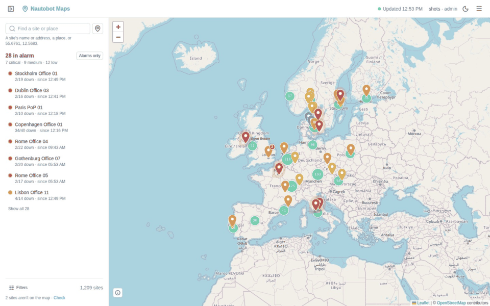

*1,200 sites, 29 in alarm: the map, a site with 34 devices down, the alert board, and a case on the top row (the [scale demo](demo/README.md#scenario-7--a-nocs-real-load)).*

## Start here

| You are… | Open | Read |
|---|---|---|
| **In the NOC**: you watch for outages and handle them | `/noc` (NOC) or `/nwo` (NWO) | [The alert board](docs/alert-board.md), [Availability](docs/availability.md) |
| **An account manager**: you tell customers whether they are affected | `/customer` | [Tenant status page](docs/status-page.md), [Availability](docs/availability.md) |
| **Keeping Nautobot up to date**: you decide what the app shows | `/` | [What to set in Nautobot and LibreNMS](docs/nautobot-setup.md) |
| **Installing or running the app** | | [Install](#install) below, then [Configuration](docs/configuration.md) and [Running in production](docs/operations.md) |
| **New to the app** and want the big picture | `/` | [How it works](docs/how-it-works.md) |

With sign-in on, `/` opens your role's page by itself ([roles](docs/authentication.md#in-short)).

Every guide is also in the app: **Documentation** in the ☰ menu.

## What it does

Built for a NOC with 1,200+ sites and 10,000+ devices, where 20–30 sites are down on a normal day. Every page puts what needs action first.

### For the NOC

- **Map**: every site, coloured by how bad things are. Sites with a problem are always their own pin; the quiet ones are grouped, so problems stand out at any zoom. Click a site for its devices, ASNs and circuits. One search box finds a site by name or address, or a place with every site within 5 km.
- **Alert board**: each site's level (Critical, Medium, Low), its down devices and since when, the likely cause, the customers on it and the case numbers. It opens on the alarms, the newest first, and updates itself. The wall view puts the ones nobody is handling first.
- **Wall view** for a NOC screen: alarms only, no buttons, and a loud warning if it stops updating. A team can have its own wall for its customers.
- **Cases**: add a case number to many down devices at once, acknowledge with a note, or copy a site as text for a ticket. Case numbers can link to your ticket system.
- **Maintenance windows** for a site or single devices, now or planned ahead: planned work is not an alarm.
- **Notifications** to Teams, email or a webhook when a site becomes Critical and when it recovers: one message per site, never one per device.
- **Filters** everywhere (map, board, Availability, Maintenance): type to find a customer, status or location type, and tick several.

### For customers and account managers

- **Status page per customer**: "are we affected?" on a private link you send them. Each of their sites, its state and its description, its devices ("3 of 12 network devices down"), and their circuits. Optionally, their own devices by name.
- **Availability** per site and customer for any month, with planned maintenance left out, and spreadsheets (CSV) down to every incident.

### For the people running it

- **Reads Nautobot, never changes it**: a read-only API token is enough. What it shows depends on what is in Nautobot ([what to set](docs/nautobot-setup.md)).
- **More sources**: LibreNMS (down within seconds with alert pushes), Prometheus Alertmanager, Zabbix or any webhook. Access points from Cisco Catalyst Center and Aruba New Central, with the switch and port each one is on.
- **Importance from Nautobot**: mark important sites (gold, silver, bronze) and devices with custom fields, and their outages alarm louder. Editing them never pages anyone.
- **Circuit mapping**: the worklist of circuits not yet linked to a site in Nautobot ([circuit mapping](docs/how-it-works.md#circuit-mapping)).
- **HTTPS and company sign-in** ready to use (nginx + oauth2-proxy for Entra ID, Keycloak, Okta, Google, GitLab), or your own sign-in proxy. Five roles, each with its own pages and buttons: customer (account managers), NOC, NWO (operator), viewer and admin ([roles](docs/authentication.md#in-short)).
- **Admin page**: API tokens, a test notification, a check of the wireless controllers, and status page links for customers.
- **Open to other tools**: an API (☰ → **API**), an MCP server for AI assistants, Prometheus `/metrics`, a `/healthz` probe, JSON logs and released Docker images.
- **One top bar on every page**: find any site, see whether the data is fresh (amber when a sync is late, red when Nautobot or LibreNMS can't be reached), who is signed in, and dark or light.

### Screenshots

| | |
|---|---|
| 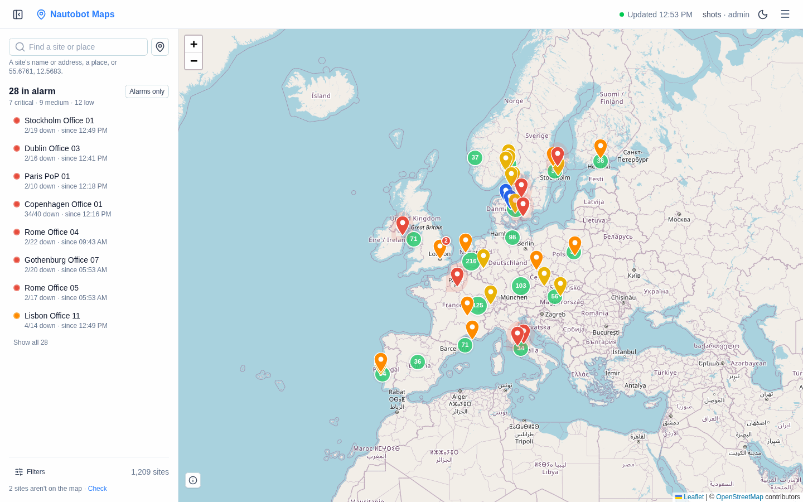 | 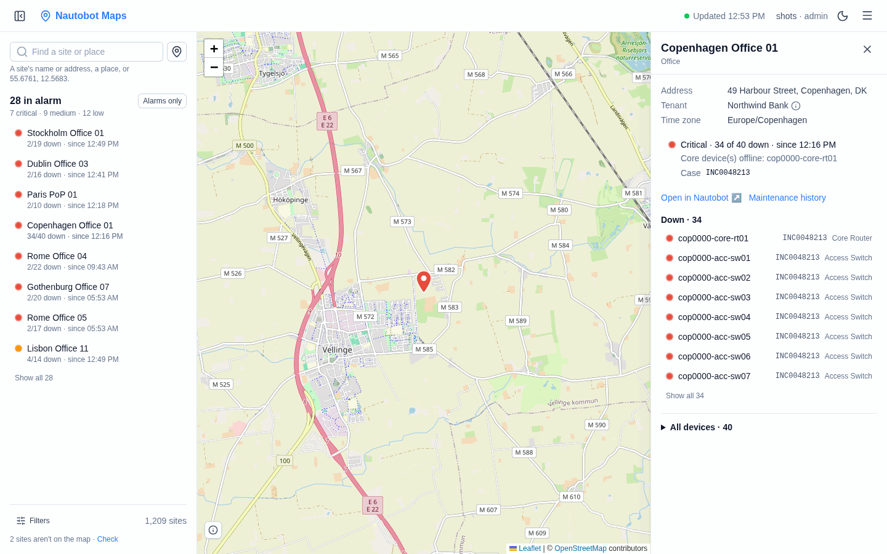 |
| **Map**: sites in alarm stand out; the rest cluster | **Site panel**: what is wrong, the devices down first, the rest folded |
| 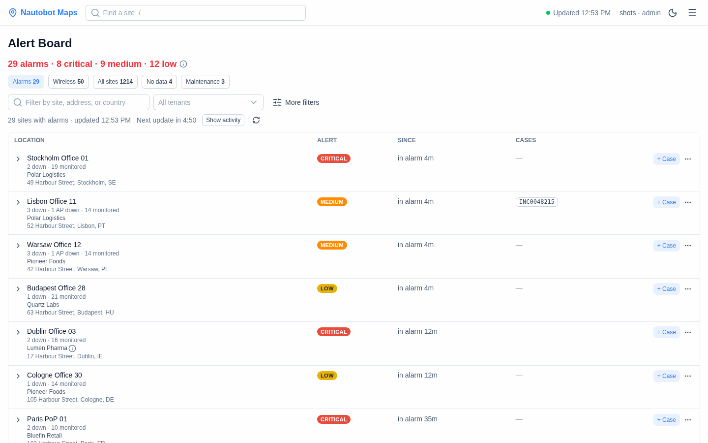 | 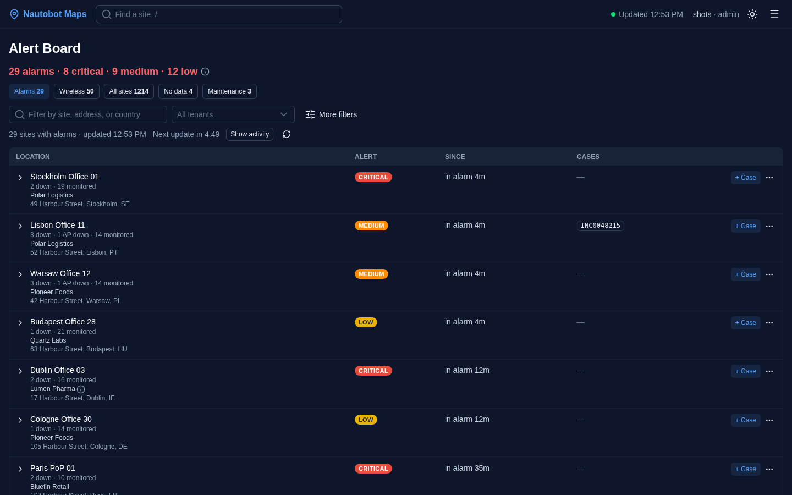 |
| **Alert board**: worst and newest first, with cases | **Dark mode**, on every page |
| 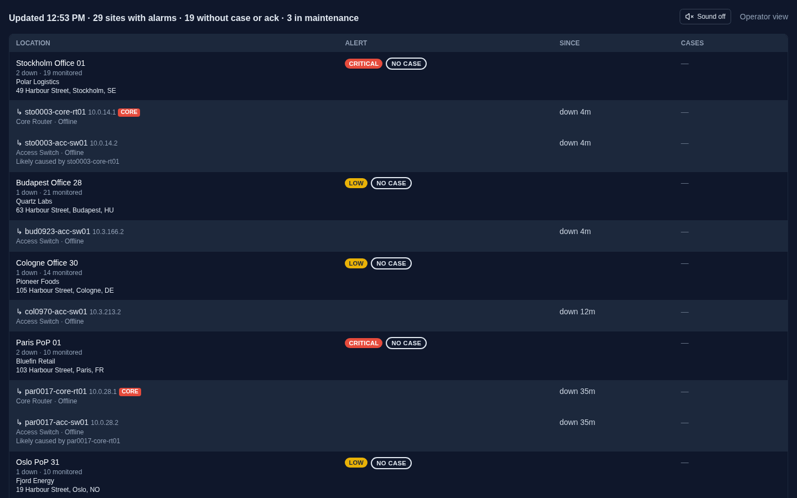 | 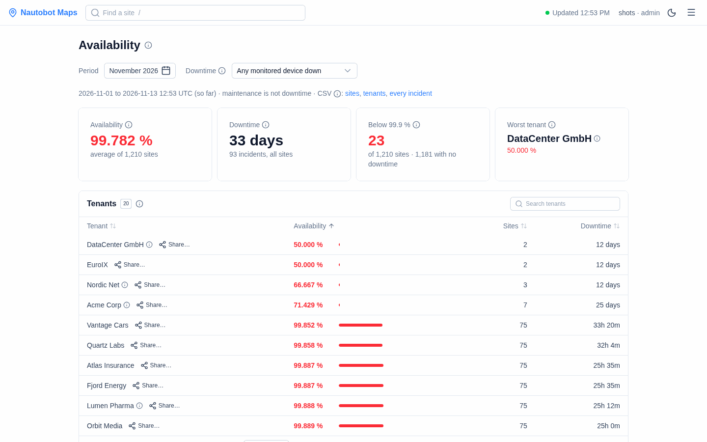 |
| **Wall view** for the NOC screen | **Availability** per site and tenant |
| 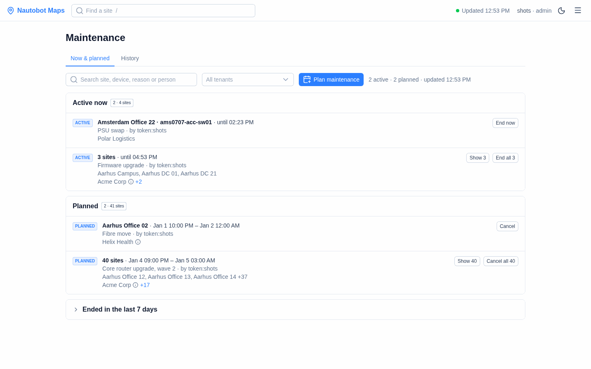 | 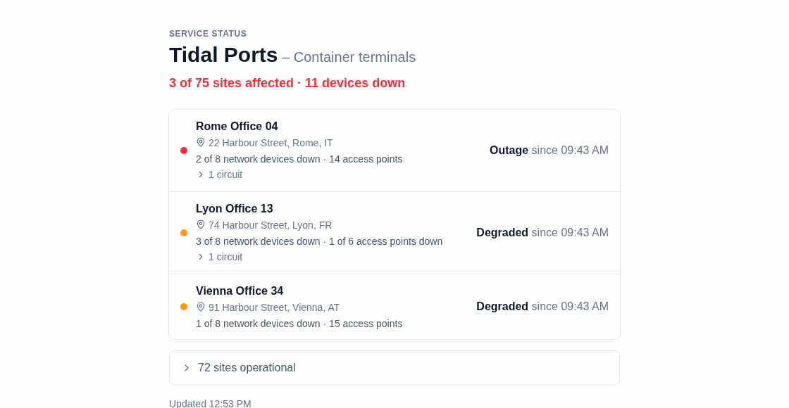 |
| **Maintenance**: now and planned, one line per change | **Status page**, as the customer sees it |
| 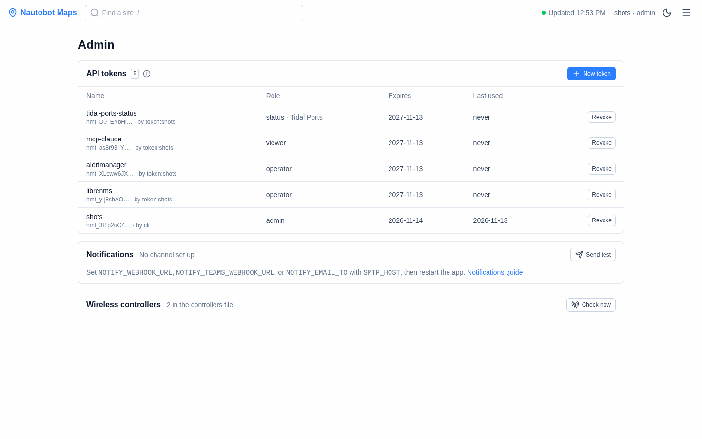 | 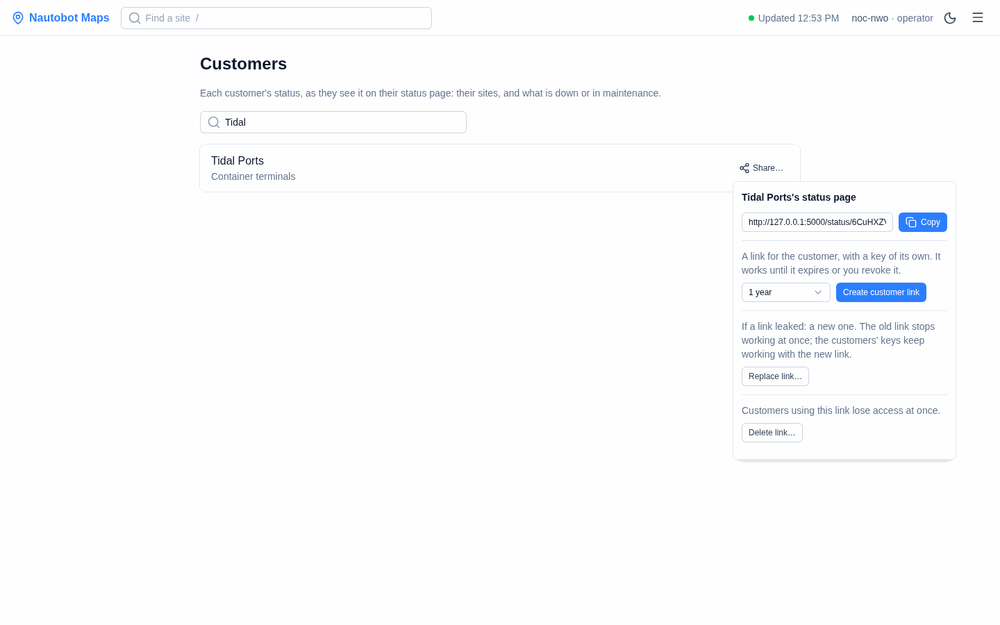 |
| **Admin**: API tokens, a test notification, the wireless check | **Customers** for NWO: each customer's status and link |
| 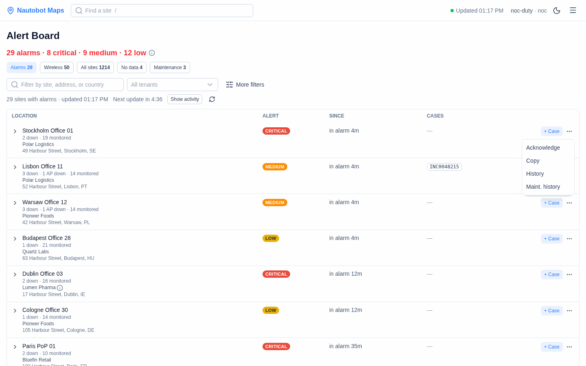 | 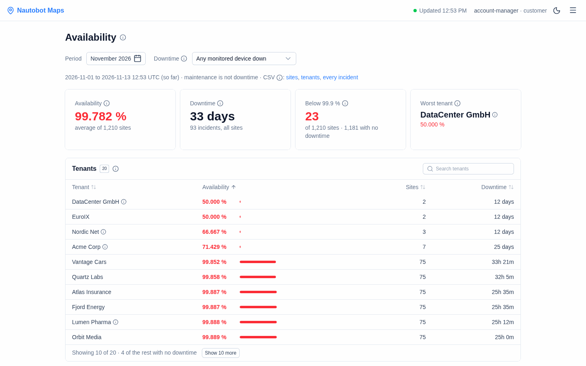 |
| **NOC** at `/noc/board`: cases and acknowledging, no maintenance | **Account managers** at `/customer`: availability, read only |

The pictures come from `scripts/screenshots.py` with the scale demo.

## Try it

No Nautobot needed: the demo comes with a mock Nautobot holding nine European sites.

```bash
docker compose -f demo/docker-compose.yml up --build
# → http://localhost:5000
```

See [`demo/README.md`](demo/README.md) for the seed data and things to try.

## Install

You need Docker and a Nautobot 2.x or 3.x with a read-only API token.

```bash
git clone https://github.com/Jackass4life/Nautobot-maps.git
cd Nautobot-maps
cp .env.example .env    # set NAUTOBOT_URL, NAUTOBOT_TOKEN and POSTGRES_PASSWORD
docker compose up --build -d
# → http://localhost:5000
```

> **Use `docker compose up`, not `docker compose build && docker compose start`.** `start` only restarts containers that already exist and fails with *"service … has no container to start"* on a fresh checkout.

- **The database:** the bundled PostgreSQL holds the alert board's data. Set `POSTGRES_PASSWORD` before the first start: it is fixed when the data volume is created.
- **Settings:** every setting is in [configuration](docs/configuration.md). In production, run a released image rather than a local build ([operations](docs/operations.md#run-a-released-version)).
- **Files the app reads** (wireless controllers, criticality rules, CA certificates) go in the **`config/`** folder next to `docker-compose.yml`. It is mounted read-only at `/config`, git-ignored and kept out of the image. In Docker the app runs as uid 10001, so let it read the folder through its group: `sudo chgrp -R 10001 config && sudo chmod 2750 config`, and `chmod 640` each file ([config/README.md](config/README.md)).
- **Two containers:** `api` (the API) and `web` (the pages, on port 5000; it passes the API's paths on to `api`). Commands run in `api`: `docker compose exec api python -m app <command>` (`token create`, `status-link`, `wireless-check`, `migrate`).
- **Without Docker** (for development): build the pages once with [bun](https://bun.sh) 1.4 (`cd web && bun install && bun run generate`), then `cd api && uv sync && uv run python run.py`. See [CONTRIBUTING.md](CONTRIBUTING.md).

### Add what you need

Each of these is optional and can be added later; the map and the board work without them.

| What | How | Guide |
|---|---|---|
| The right data in Nautobot | Coordinates, primary IPs, tenants, and optional custom fields | [What to set in Nautobot and LibreNMS](docs/nautobot-setup.md) |
| HTTPS and company sign-in | The bundled nginx + oauth2-proxy (`COMPOSE_FILE=docker-compose.yml:reverse-proxy/compose.yml`), or your own sign-in proxy | [Sign-in and roles](docs/authentication.md) |
| LibreNMS status | `LIBRENMS_URL`, `LIBRENMS_API_TOKEN`; alert pushes for near-real time | [LibreNMS](docs/nautobot-setup.md#librenms-optional) |
| Access points from Catalyst Center or Aruba New Central | `config/wireless.yml` and `WIRELESS_CONTROLLERS_FILE=/config/wireless.yml` | [Other sources](docs/sources.md#wireless-controllers-access-points) |
| Alertmanager, Zabbix or any webhook | An operator API token | [Other sources](docs/sources.md) |
| Notifications (webhook, Teams, email) | `NOTIFY_*`, `SMTP_*` | [Notifications](docs/notifications.md) |
| A status page per customer | A private link per tenant, from **Share…** on Availability or Customers | [Tenant status page](docs/status-page.md) |
| Case numbers that link to your ticket system | `CASE_URL_TEMPLATE=https://itsm.example.com/ticket/{case}` | [Configuration](docs/configuration.md#alert-board) |
| Which sites and devices matter most | Custom fields in Nautobot | [How serious an outage is](docs/nautobot-setup.md#how-serious-an-outage-is) |
| Your availability target (SLA) | `AVAILABILITY_TARGET_PCT=99.5` (default 99.9) | [Availability](docs/availability.md) |
| AI assistants | `MCP_ENABLED=true` and an API token | [MCP server](docs/mcp.md) |

### Criticality in Nautobot

Moved to [How serious an outage is](docs/nautobot-setup.md#how-serious-an-outage-is): the `tier` and `criticality` custom fields, and the settings that go with them.

## Documentation

Every guide below is also in the app: **Documentation** in the ☰ menu (`/help`).

| | |
|---|---|
| [How it works](docs/how-it-works.md) | The big picture: the building blocks, the data flow, setup, and what the app can and can't do |
| [What to set in Nautobot and LibreNMS](docs/nautobot-setup.md) | Every field the app reads, required and optional, where to set it |
| [The alert board](docs/alert-board.md) | Alert levels, hiding sites and devices, one row per Site, cases, wall view |
| [Availability](docs/availability.md) | Uptime per site and customer, by month, without maintenance |
| [Tenant status page](docs/status-page.md) | "Are we affected?" for one customer, on a private link |
| [Notifications](docs/notifications.md) | Webhook, Teams and email when a site's level changes |
| [Configuration](docs/configuration.md) | Every setting |
| [Running in production](docs/operations.md) | Released images, overrides, backup and restore, migrations, monitoring |
| [Sign-in and roles](docs/authentication.md) | The bundled HTTPS and sign-in proxy, or your own; what each role can do; API tokens |
| [Other monitoring sources](docs/sources.md) | Wireless controllers, Prometheus Alertmanager, Zabbix and a generic webhook |
| [MCP server](docs/mcp.md) | Connecting AI assistants |
| [Data contract](docs/data-contract.md) | Exactly what is read from Nautobot, LibreNMS and the controllers, and what it becomes |
| API | **API** in the ☰ menu opens `/api/docs`: every endpoint in Swagger UI with **Try it out**, and the OpenAPI spec at `/api/openapi.json` (the old `/docs` and `/openapi.json` redirect there) |
| [CHANGELOG.md](CHANGELOG.md) | What changed in each release |
| [CONTRIBUTING.md](CONTRIBUTING.md) | Development setup, tests, code layout |

## Nautobot versions

Tested with Nautobot 2.x and 3.x. In 3.x, ASNs are read from the field on each Location (the `ipam/asns/` endpoint needs the BGP Models plugin), and names missing from brief nested objects are looked up separately, so both work without extra setup.

## License

[Apache License 2.0](LICENSE).
