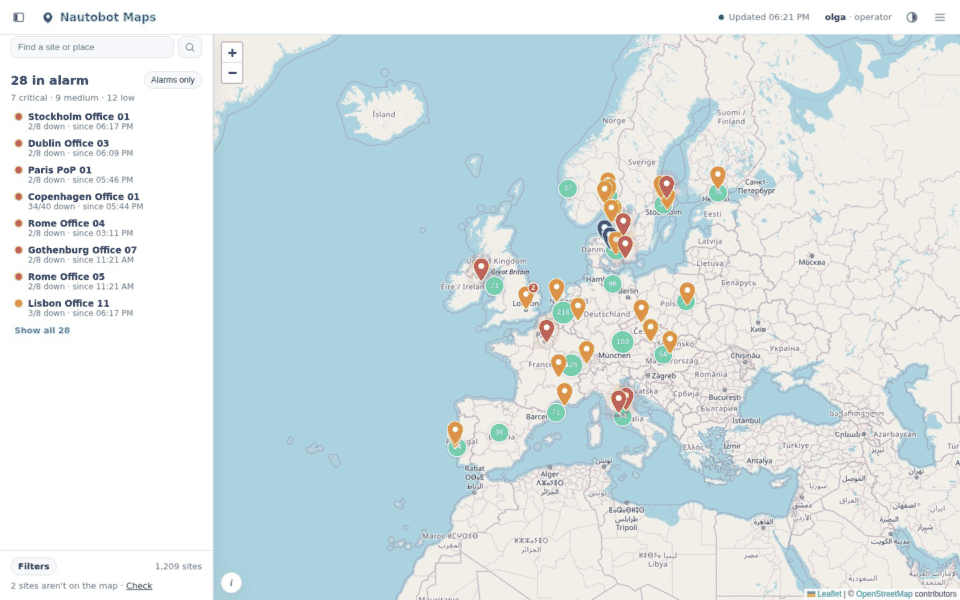
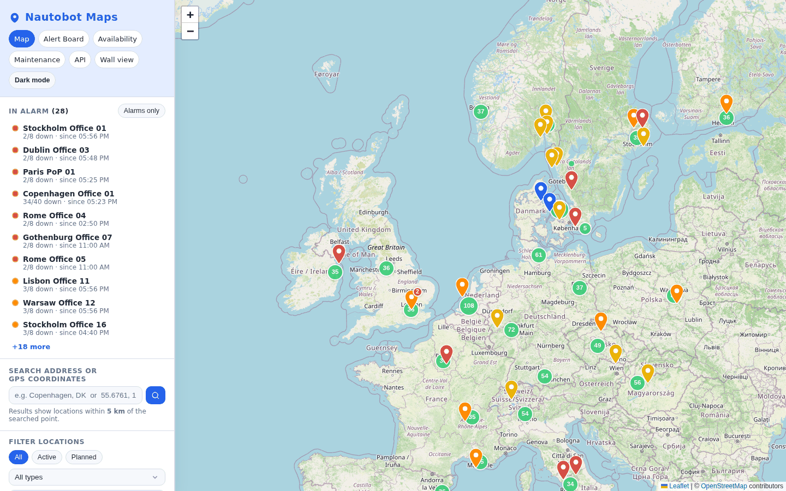
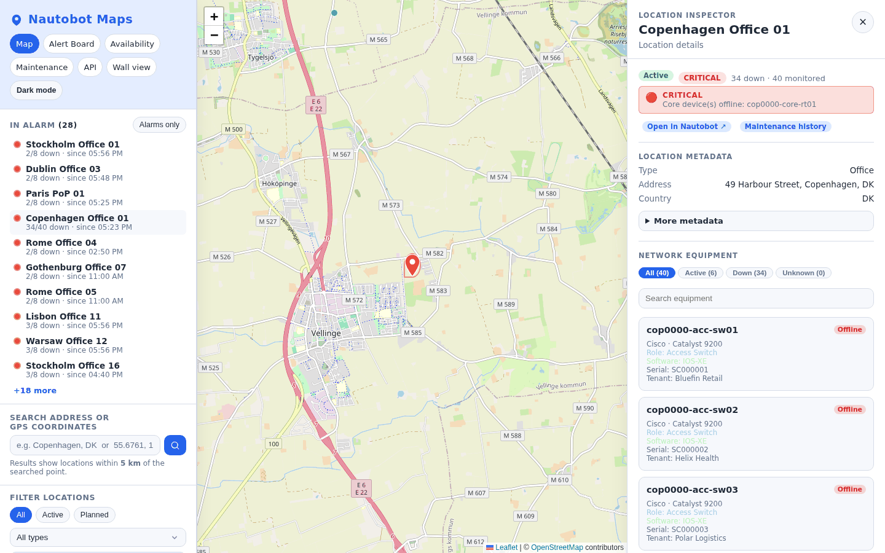
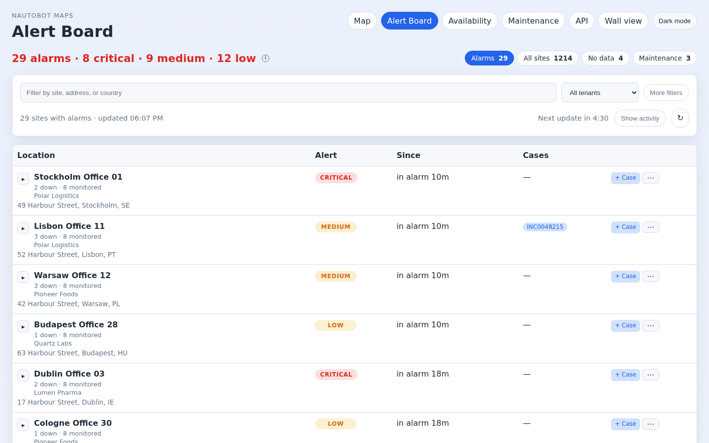
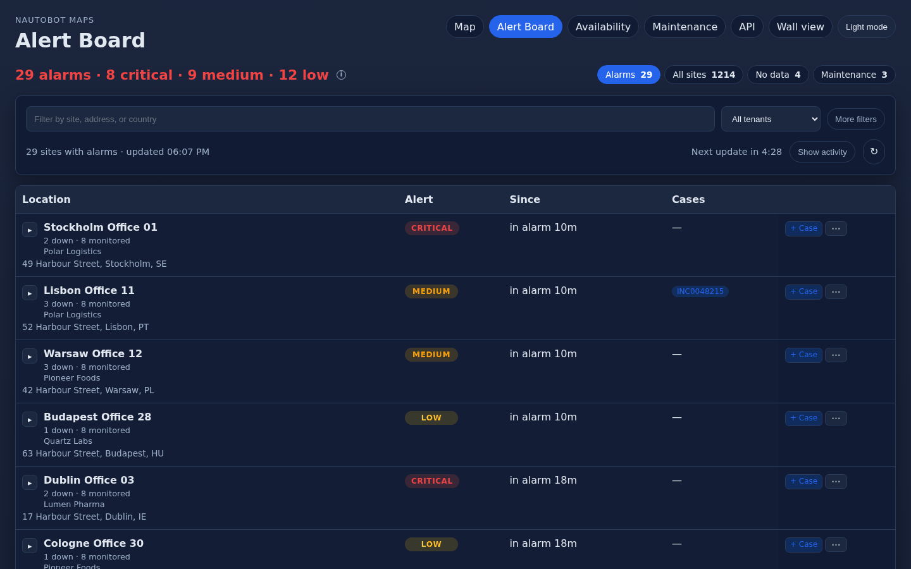
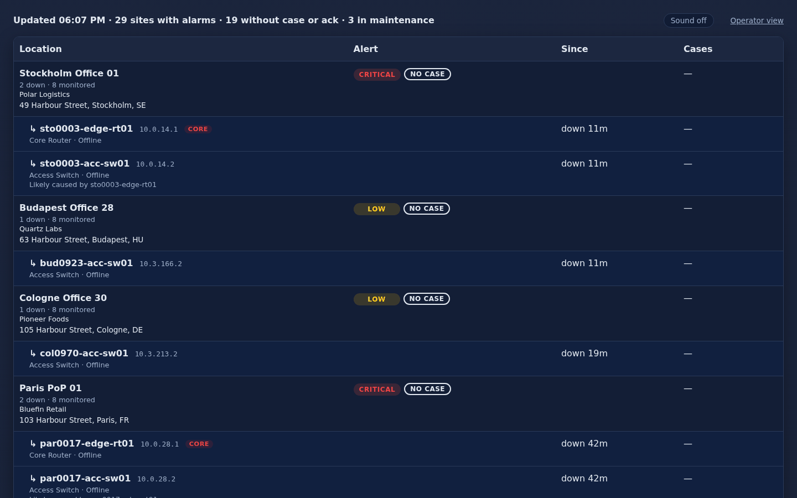
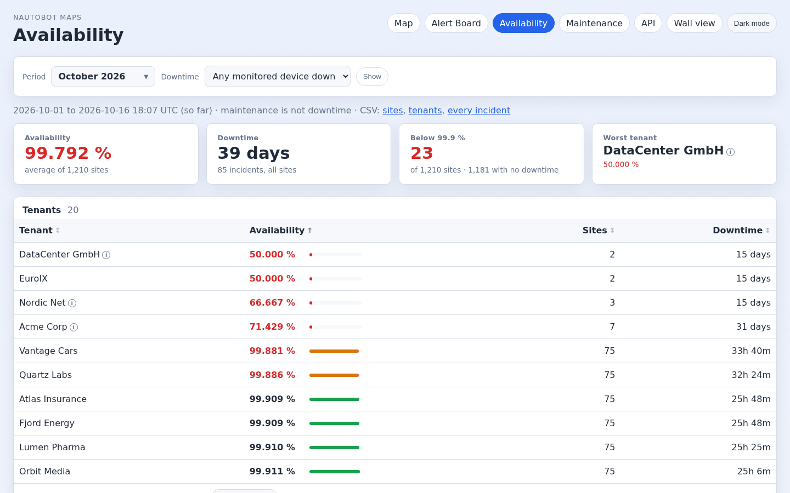

# Nautobot Maps

Your Nautobot sites on a map, and an alert board that shows which sites are down, since when, and who has a case on them.



*1,200 sites, 29 in alarm: the map, a site with 34 devices down, the alert board, and a case on the top row (the [scale demo](demo/README.md#scenario-7--a-nocs-real-load)).*

## Features

Built for a NOC: 1,200+ sites and 10,000+ devices, with 20–30 sites down on a normal day. Lists summarise and put what needs action first.

- **Map** of every Nautobot location with coordinates, coloured by alert level. Sites in alarm or maintenance are always their own pin; the rest cluster, so the sites that need action stand out at any zoom. Click a site for its devices, ASNs and circuits; search by address or `lat,lon` for sites within 5 km.
- **Alert board**: each site's level (Critical, Medium, Low), its down devices with IP, role and down-since time, the likely cause, downtime, tenants and case numbers. It opens on sites with alarms, the ones nobody is on first, and updates itself.
- **Wall view** for a NOC screen: alarms only, no buttons, and a loud warning when it stops updating.
- **Cases and ITSM**: attach a case number to many down devices at once, acknowledge with a note, or copy a site as text for a ticket. History and an activity feed show what went down and came back.
- **Maintenance windows** for sites or single devices, now or planned ahead: planned work is not an alarm. A history of every window, with CSV.
- **Availability** per site and tenant for any period, with maintenance left out, and CSV exports down to every incident.
- **Tenant status page**: "are we affected?" for one tenant, shareable with a customer.
- **More sources**: LibreNMS status (optional) next to Nautobot's, pushed within seconds by LibreNMS alerts; Prometheus Alertmanager and a generic webhook can mark devices down.
- **Notifications** to a webhook, Microsoft Teams or email when a site becomes Critical and when it recovers, summarised, never one per device.
- **Sign-in and roles** through your SSO proxy (viewer, operator, admin), and **API tokens** for scripts and MCP clients.
- **MCP server** (optional) so AI assistants can read the board and add cases.
- **Operations**: Prometheus `/metrics`, a `/healthz` probe, JSON logs, released Docker images.
- **Read-only towards Nautobot**: the app never changes anything there, so a read-only API token is enough.

### Screenshots

| | |
|---|---|
|  |  |
| **Map**: sites in alarm stand out; the rest cluster | **Site panel**: the level, why, and every device |
|  |  |
| **Alert board**: worst and newest first, with cases | **Dark mode**, on every page |
|  |  |
| **Wall view** for the NOC screen | **Availability** per site and tenant |

The pictures come from `scripts/screenshots.py` with the scale demo.

## Try it

No Nautobot needed: the demo comes with a mock Nautobot holding nine European sites.

```bash
docker compose -f demo/docker-compose.yml up --build
# → http://localhost:5000
```

See [`demo/README.md`](demo/README.md) for the seed data and things to try.

## Install

You need Docker and a Nautobot 2.x or 3.x with an API token.

```bash
git clone https://github.com/Jackass4life/Nautobot-maps.git
cd Nautobot-maps
cp .env.example .env    # set NAUTOBOT_URL, NAUTOBOT_TOKEN and POSTGRES_PASSWORD
docker compose up --build -d
# → http://localhost:5000
```

> **Use `docker compose up`, not `docker compose build && docker compose start`.** `start` only restarts containers that already exist and fails with *"service … has no container to start"* on a fresh checkout.

The bundled PostgreSQL holds the alert board's data. Set `POSTGRES_PASSWORD` before the first start: it is fixed when the data volume is created. For LibreNMS, sign-in and everything else, see [configuration](docs/configuration.md). In production, run a released image rather than a local build ([operations](docs/operations.md#run-a-released-version)).

Without Docker (for development): `pip install -r requirements.txt`, then `python app.py`. See [CONTRIBUTING.md](CONTRIBUTING.md).

## Documentation

| | |
|---|---|
| [How it works](docs/how-it-works.md) | The building blocks, the data flow, setup, and what the app can and can't do |
| [Configuration](docs/configuration.md) | Every setting |
| [The alert board](docs/alert-board.md) | Alert levels, hiding sites and devices, one row per Site, cases, automatic updates, wall view |
| [Running in production](docs/operations.md) | Released images, overrides, backup and restore, migrations, monitoring |
| [Availability](docs/availability.md) | Uptime per site and tenant, by month, without maintenance |
| [Tenant status page](docs/status-page.md) | "Are we affected?" for one tenant, shareable with a customer |
| [Other monitoring sources](docs/sources.md) | Prometheus Alertmanager and a generic webhook mark devices down |
| [Notifications](docs/notifications.md) | Webhook, Teams and email when a site's level changes |
| [Sign-in and roles](docs/authentication.md) | SSO proxy setup, what each role can do, API tokens |
| [Data contract](docs/data-contract.md) | What is read from Nautobot and LibreNMS, and what it becomes |
| [MCP server](docs/mcp.md) | Connecting AI assistants |
| API | **API** in the app's top bar opens `/docs`: every endpoint with its parameters and a **Try it** button |
| [CHANGELOG.md](CHANGELOG.md) | What changed in each release |
| [CONTRIBUTING.md](CONTRIBUTING.md) | Development setup, tests, code layout |

## Nautobot versions

Tested with Nautobot 2.x and 3.x. In 3.x, ASNs are read from the field on each Location (the `ipam/asns/` endpoint needs the BGP Models plugin), and names missing from brief nested objects are looked up separately, so both work without extra setup. Only locations with both latitude and longitude appear on the map.

## License

[Apache License 2.0](LICENSE).
