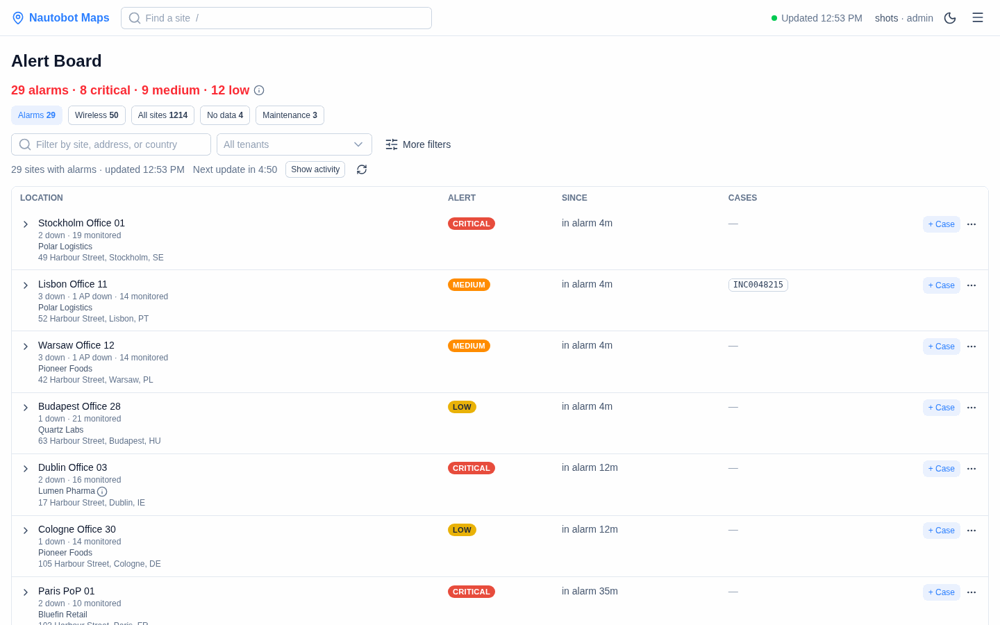
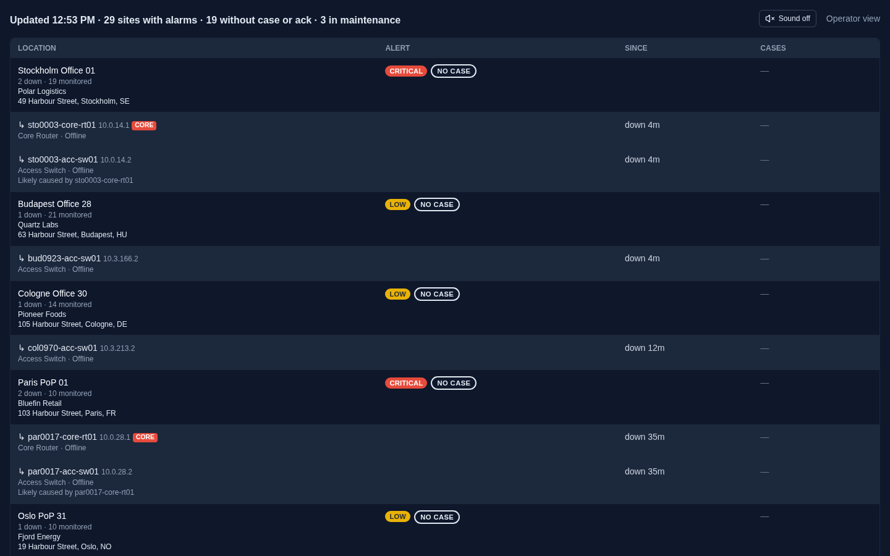

# The alert board

The alert board (**Alert Board** in the ☰ menu, `/alerts`) is the NOC's to-do list. It shows which sites have a problem right now, how bad it is, since when, and whether someone is already on it.

- **[Using it](#using-it)**: reading the board, handling an alarm, maintenance and the wall screen.
- **[Setting it up](#setting-it-up)**: what it needs from Nautobot and which settings change it.
- **[Details](#details)**: the exact rules, for when you need to know why a site has the level it has.

## Using it

### Reading the board



- **The top line** says what is wrong right now, for example "2 alarms · 1 critical · 1 medium". The **(i)** next to it explains the levels.
- **The chips** choose which sites are listed:
  - **Alarms**: sites at Critical, Medium or Low. The board opens here.
  - **Wireless**: sites where only access points are down (shown only when there are some).
  - **All sites**, **No data** and **Maintenance**, each with its count.
- **Each row** is one site:
  - its name, with its customers (tenants) underneath, and where it is;
  - how many devices are down, for example "1 down · 3 APs down · 46 monitored";
  - its **level** (hover it to see why, for example "2/7 devices offline (29%)");
  - **since** when: a site is **in alarm 3h 40m** (since its first device that is still down went down), a device is **down 25m**. Over two days, times are in days;
  - its **case numbers**, and **+ Case**;
  - more actions under **⋯**: Acknowledge, Copy, Maint., History and Maint. history.
- **Order:** the newest outage first (sites with only access points down after the alarms). **More filters → Sort** can order by severity or by site name instead, and remembers your choice. On the wall view, the sites nobody is handling come first.
- **Many sites:** the first 200 rows are shown, and **Show 200 more** adds the next. A refresh keeps what you opened.
- **On a phone** the actions stay at the right edge, and the Cases column is left out (the cases are in **+ Case** and **Copy**).

### What the levels mean

| Level | Colour | Means |
|---|---|---|
| **Critical** | Red | Something important is down: a core device, a device or site marked critical, or every device at the site |
| **Medium** | Orange | A larger part of the site is down (more than a quarter of its devices, by default) |
| **Low** | Yellow | Some devices are down, but most of the site works |
| **Wireless** | Soft yellow | Only access points are down. Not an alarm, never notified |
| **Maintenance** | Blue | Planned work. Not an alarm |
| **No data** | Grey | Nothing at the site is monitored, or its level couldn't be worked out. Not an alarm |
| **OK** | Green | Everything monitored is up |

The exact rules: [alert levels](#alert-levels).

### Finding a site

- **Search** for a site by name, path, address or country.
- **Tenant**: pick one or more customers, found by their name or by their description in Nautobot (for example "Container" finds "Tidal Ports – Container terminals").
- **More filters** has the sort order, status, location type and **Show non-operational sites**.
- **Reset** clears every filter.

In every list you can type to search, use the arrow keys, press Enter to tick, and Escape to close.

### Handling an alarm

- **+ Case** adds a case or ticket number to the site's down devices. Devices without a case start ticked. A new number is added next to an existing one, never instead of it. The case stays on the site and its devices until the alarm ends.
- **Acknowledge** (under **⋯**) says "someone is on it" without a case number: one click acknowledges every down device of the site. For a note, or for some devices only: **+ Case**, then "Or acknowledge without a case". **Remove ack** takes it back.
- **Copy** (under **⋯**) puts the site and its down devices on the clipboard as plain text, ready to paste into a ticket.
- **History** (under **⋯**) shows when each device went down and came back, with the cases, and **Export** downloads it as a spreadsheet (CSV).
- **Activity** (the right-hand panel) lists the latest changes: devices down and back up, and sites changing level.

Adding cases and acknowledging need the **operator** role when sign-in is on ([roles](authentication.md)).

### Planning maintenance

Planned work should not raise an alarm. Put the site, or some of its devices, in **maintenance** first:

- **For one site:** **Maint.** under the row's **⋯**: the whole site or ticked devices, now for 1–8 hours or planned on a calendar, with a reason.
- **For many sites, or ahead of time:** **Maintenance** in the ☰ menu → **Plan maintenance**. Add sites by name or customer (**Add all 40 sites of Acme**), pick **Now, for** 1–8 hours or **Planned** dates and times, and give a reason. Up to 200 sites at once.
- **While it runs, for the whole site:** the site shows a blue **MAINTENANCE** badge with "until 14:00 · reason" instead of its level, and nobody is notified.
- **While it runs, for some devices:** only those devices are left out. The site keeps its level from its other devices, which can still raise an alarm and notify.
- **Ending early:** **End now**, or **Cancel** for one that hasn't started.

Starting, ending and cancelling need the **operator** role. More: [maintenance windows](#maintenance-windows).

### The wall view (NOC screen)



**Wall view** in the ☰ menu is for a screen nobody clicks on: sites in alarm only, each with its address, down devices and cases, and no buttons.

- **Who's on it:** **NO CASE** means nobody has picked the site up. A blue **✓ INC-1234** or **✓ ACK** means it is handled; those sites turn grey and move below a dashed line. So the bright rows at the top need someone.
- **Is it up to date?** It reloads every minute and shows "Updated 14:05". After 10 minutes without an update it says **NOT UPDATED** in red, and if the board can't be loaded it shows a red banner, so a frozen screen never looks like "all OK".
- **Bigger text on a TV:** use the browser's zoom (Ctrl/⌘ +).
- **Sound:** **Sound on** (top right) chimes and shows a browser notification once when a site becomes Critical, and once when a site in alarm has nobody on it.
- **A wall for one team:** pick the customers or type a filter on the board, then **Copy wall link**, and open that link on the screen ([walls for some sites](#a-wall-for-some-sites-only)).

### On the map

The map uses the same levels: a site's colour and its panel ("MEDIUM · 2 down · 7 monitored") come from the board. Sites in alarm or maintenance are always their own pin, so they stand out at any zoom.

## Setting it up

### In Nautobot

The board shows what Nautobot says. At the least, sites need **coordinates** (for the map) and devices need a **primary IP** (to be watched). Everything else is optional: customers, important sites, device levels, access point roles, location types and statuses to hide.

All of it, with where to click: [What to set in Nautobot and LibreNMS](nautobot-setup.md).

### In the app

| You want… | Setting | More |
|---|---|---|
| A database (the board needs one) | `NAUTOBOT_MAPS_DATABASE_URL` (bundled with Docker) | [Configuration](configuration.md#database-postgresql) |
| One row per Site, not per floor | `ALERT_BOARD_SITE_LOCATION_TYPE=Site` | [One row per Site](#one-row-per-site) |
| Hide old or planned sites and devices | `ALERT_BOARD_EXCLUDED_*` | [Hiding sites and devices](#hiding-sites-and-devices) |
| Important sites first, and louder | `SITE_TIER_FIELD`, `TIER_DEVICE_LEVEL` | [Importance tier](#importance-tier) |
| A device's own level | `DEVICE_CRITICALITY_FIELD` | [Device and site criticality](#device-and-site-criticality) |
| Other share-down thresholds | `ALERT_MEDIUM_PERCENT`, `ALERT_CRITICAL_PERCENT` | [Alert levels](#alert-levels) |
| Ignore short blips | `ALERT_DELAY_SECONDS` | [Alert delay](#alert-delay) |
| Case numbers that open your ticket | `CASE_URL_TEMPLATE=https://itsm.example.com/ticket/{case}` | [Cases, Copy and history](#cases-copy-and-history) |
| Down within seconds | LibreNMS alert pushes | [LibreNMS](nautobot-setup.md#librenms-optional) |
| Access points from a controller | `WIRELESS_CONTROLLERS_FILE` | [Access points](#access-points) |

Every setting: [configuration](configuration.md#alert-board).

Without PostgreSQL the board stays empty and says so (a warning is logged at startup). The map works either way.

## Details

### Alert levels

Each site gets one level, from its **monitored devices**: devices with a primary IP in Nautobot (`primary_ip`, `primary_ip4` or `primary_ip6`), and access points a [wireless controller](#access-points) lists, after [exclusions](#hiding-sites-and-devices). This keeps unmonitored devices off the board without removing them from the map.

| Level | When |
|---|---|
| **Critical** | A core or critical device is down, or at least `ALERT_CRITICAL_PERCENT` of the monitored devices are down (default 100: all of them) |
| **Medium** | More than `ALERT_MEDIUM_PERCENT` of the monitored devices are down (default 25%) |
| **Low** | At least one monitored device is down, `ALERT_MEDIUM_PERCENT` or fewer |
| **No data** | No monitored devices, or the level could not be computed. Not an alarm |
| **OK** | Monitored devices, none down |

Down or up comes from the device's status in Nautobot (`Offline`, `Failed` and `Decommissioning` are down), and from LibreNMS when it is configured.

A device is **core** when its role contains a critical keyword, or when it is marked critical by an override (`/api/v1/criticality-overrides`). The keywords are `CRITICAL_ROLE_KEYWORDS` (default `core,spine,distribution,router,gateway`), or per location type from `CRITICALITY_RULES_FILE` (see `criticality_rules.json`).

### Device and site criticality

Which devices matter can be set in Nautobot ([where](nautobot-setup.md#how-serious-an-outage-is)). Each down device gives its site a level, from the first of these that applies:

1. **The device's own field**: a custom field on the device named by `DEVICE_CRITICALITY_FIELD`, a select with `critical`, `medium` or `low`.
2. Else the worst of:
   - **an override** in this app (`/api/v1/criticality-overrides`): critical; "not critical" only stops its role from making it critical;
   - **a core role keyword**: critical;
   - **the site's tier**, through `TIER_DEVICE_LEVEL`, e.g. `gold:critical,silver:medium`: every device of a gold site counts as critical. A tier not listed sets nothing, and a tier's default never lowers a core device.

The site's level is the worst of its down devices' levels, the share of devices down (the table above), and Critical when all are down. So a device set to `low` on a gold site doesn't make it Critical, but many `low` devices down still raise it by their share. With nothing set, the levels are as before.

The reason says why: "Critical device(s) offline: fw01 (set in Nautobot)", "Medium device(s) offline: sw03 (silver site)"; a core role or an override keeps "Core device(s) offline: core01". A down device with a level set on it in Nautobot has a quiet **SET LOW** / **SET MEDIUM** / **SET CRITICAL** mark; a tier's default isn't marked, as it would be on every device of the site.

**Editing a tier or a level doesn't page anyone.** When a site's level changes but its down devices are the same as at the last board build (a criticality field, a tier or a setting was changed), the change is in the activity feed but not notified. A device going down or coming back is notified as usual, also in the same minute as an edit. Changing a down device's **role** is not covered: a new core role can make the site Critical and notify. Right after the upgrade that added this, nothing is known yet, so the first build's changes are notified; turn on `TIER_DEVICE_LEVEL` after that build to keep it quiet. The availability report's `critical` basis follows these levels from then on; past downtime is not recalculated.

The field is read with the device sync. Setting or changing `DEVICE_CRITICALITY_FIELD` or `SITE_TIER_FIELD` makes the next sync a full one, so the values arrive within one sync.

### Access points

Access points get their address by DHCP, so Nautobot seldom has one. With [wireless controllers](sources.md#wireless-controllers-access-points) set up, the controller watches them instead:

- **Monitored without a primary IP.** A Nautobot device the controller lists (by serial, else by name for an access point) counts at its site. Its address is the one the controller reports, on the board, in **Copy** and in the map's site panel ("IP 10.20.31.47 · from Catalyst Center dk"); it is never written to Nautobot.
- **Down when the controller says so**, until it says it is up again, or the device gets a status in `ALERT_BOARD_EXCLUDED_DEVICE_STATUSES` (e.g. Decommissioning) in Nautobot. Its row says who says so: "per Catalyst Center dk". If the controller can't be reached, its last answer stays, marked "last known per Catalyst Center dk, which can't be reached". Maintenance, acknowledgements, cases, the alert delay and flapping work as for any device.
- **Only access points down** makes a site `WIRELESS_AP_LEVEL` (default Low): listed under the **Wireless** chip, not **Alarms** ("down 2m", not "in alarm"), after every alarm on **All sites**; not on the wall, not in the map's alarm list (a soft yellow dot, grouped with the quiet sites), never notified, and Operational on the [status page](status-page.md) with them counted. An access point with a level set in Nautobot (`DEVICE_CRITICALITY_FIELD`), or marked critical by an override, is an alarm at that level like any device, and is notified like one.
- **They never water down the others.** The share of devices down is of the other devices only: at a site with 6 switches and 40 access points, one switch down is 1 of 6, not 1 of 46. A site with a switch down and access points down is in **Alarms** at the switch's level: the access points are counted, never raising it (unless one has a level set).
- **Many fold away.** A row lists up to 3 access points with the other down devices; more fold into one line, "34 access points down", that opens in place (on the wall, a count only). The site panel lists them in their own fold, open only when nothing else is down.
- **Quiet elsewhere too:** they are in each site's **History** and its CSV, but not in the activity feed, nor in [availability](availability.md).
- **Which switch and port:** a down access point's line (opened row, the map's site panel) says "Connected to hel0008-acc-sw02 · Gi1/0/14", and **Copy** lists the access points under their switch. With two or more down at a site behind one switch, the row says "12 of 16 behind hel0008-acc-sw02" (and so does **Copy**): the switch, its uplink or its PoE is the likely problem, not 12 access points. From Catalyst Center's physical topology (CDP/LLDP) when it knows, else a Nautobot cable between the access point and the switch; a site with no neighbours known shows nothing.
- **Being onboarded with Plug and Play** (Catalyst Center): an access point in Nautobot that the controller's inventory doesn't list yet, but its Plug and Play does, isn't down and isn't watched yet. The map's site panel says where it is, "Onboarding (PnP: Unclaimed) · per Catalyst Center dk", or "PnP error" with the reason, instead of "Not monitored". The board shows nothing for it, and it is never notified. Once it has joined its controller, the inventory decides whether it is up.

### Hiding sites and devices

Non-operational locations are hidden by default: those whose type is in `ALERT_BOARD_EXCLUDED_LOCATION_TYPES` (default `graveyard,warehouse`), or whose status, tag or name is in the matching `ALERT_BOARD_EXCLUDED_LOCATION_*` setting. **More filters → Show non-operational sites** shows them anyway. Hidden sites stay on the map.

Devices can be ignored by status with `ALERT_BOARD_EXCLUDED_DEVICE_STATUSES`: they are not counted and not listed, so for example a Decommissioning device no longer makes its site Critical. The same goes for a device LibreNMS has **Disable polling and alerting**, **Disable alerting** or **Ignore alert tag** set for, whatever its status in Nautobot or another source; the site panel says which ([in LibreNMS](nautobot-setup.md#a-device-you-dont-want-alarms-for)). In both status settings, `null` matches a missing or empty status:

```bash
ALERT_BOARD_EXCLUDED_LOCATION_STATUSES=null,decommissioning,planned
ALERT_BOARD_EXCLUDED_DEVICE_STATUSES=null,decommissioning,planned
```

### One row per Site

With a location hierarchy such as Region › Country › Site › Building › Floor, set the level the board should show:

```bash
ALERT_BOARD_SITE_LOCATION_TYPE=Site
```

Only locations of that type (case-insensitive) get a row. Levels above it are shown as a path, e.g. `EMEA › DNK`. Devices in child locations count towards their Site (device count, level, downtime), and a down device's row says where it is, e.g. `Bygning A › Etage 2`. Devices below an excluded location (e.g. a Decommissioning building) are left out. A location with devices but no Site above it keeps its own row and is logged once. Changing the setting moves open alerts from building/floor rows to their Site, which restarts their downtime once.

A site's **country** (the board's search, MCP, the availability CSV; the map shows the address, not a country) is Nautobot's own country field if it has one; else the name of the nearest location of type **Country** above it (`DNK` here; the type is `COUNTRY_LOCATION_TYPE`); else the address's last part, but only when it has no digits and isn't the town after a street and number or a postcode (`…, 2300 Copenhagen, Denmark` and `Copenhagen, Denmark` give Denmark; `Roersvej 33, 5000 Odense C` and `Roersvej 33, 5000, Odense C` give none). An address can still end in something that isn't a country (`10 Downing Street, Westminster, London`): a Country location in Nautobot is the sure way. Renaming or moving a location that others are under makes the next sync a full one, so their countries follow within one sync interval.

### Importance tier

Not every site matters the same. With `SITE_TIER_FIELD` set to a Nautobot custom field on the location (e.g. `tier`, with values `gold`, `silver`, `bronze`), each site shows its tier by its name (the most important one accented). Among sites at the same level, the more important come first, on the board and the wall. `SITE_TIERS` lists the values, most important first (default `gold,silver,bronze`); other values count as no tier. `NOTIFY_MIN_LEVEL_BY_TIER` can make important sites notify sooner ([notifications](notifications.md)).

### Likely cause

When a **core** device at a site is down, the site's other down devices are probably down because of it. The board and the wall list the core device first, marked **CORE**, and each other down device says "Likely caused by core-rt01". Copy, notifications ("Likely cause: core-rt01 down; 2 other devices probably behind it") and the history (panel and `probable_cause` in the incidents CSV) say the same. It is a guess from the roles, not from cabling: a device can be down for its own reason while its core is down too. Access points are the exception: they say which switch they are behind ([access points](#access-points)).

### Alert delay

With `ALERT_DELAY_SECONDS` (default `0`: off), a device must be down that long before it alarms. Until then it is not shown, not counted in the site's level, not recorded in the history and not notified; if it comes back sooner, it never happened. When it does alarm, its incident starts when it went down, so the downtime is right.

The app sees a device's state when the board is built (after every sync, or at once with [LibreNMS alert pushes](configuration.md#near-real-time-status-librenms-alert-pushes)), so the delay is counted in those steps. LibreNMS has its own alert delay: set one or the other, not both.

### Flapping

A device that goes up or down `FLAP_CHANGES` times (default `4`; `0`: off) within 30 minutes is **flapping**: it is unstable rather than dead, which usually means a link, power or a loop rather than the device itself. While it flaps:

- it is listed with a **FLAPPING** label (hover it for how many times), also when it is up for a moment;
- it stays **one incident** in the history and the CSV, and keeps its case;
- it counts as down, so the site's level doesn't bounce and nothing is notified again and again.

When it has been steady for 30 minutes, the incident closes at the time it came back up. Short blips under the [alert delay](#alert-delay) count too: a device that keeps blipping shows as flapping instead of staying hidden.

### Maintenance windows

A **maintenance window** covers a whole site or some of its devices, from a start (now, or planned ahead) to an end, with a reason.

- **A site in maintenance** shows a blue **MAINTENANCE** badge with "until 14:00 · reason" instead of its level. It is not counted as an alarm (the **Maintenance** chip counts it), and on the wall view it is listed at the bottom under **In maintenance**. On the map it is blue.
- **A device in maintenance** is left out when the site's level is worked out; if it is down, its row says "MAINTENANCE until 14:00 · reason".
- While a window is active, the alert history is **frozen** for what it covers: nothing opens, and open alerts are neither updated nor closed.
- **Notifications:** none when a site goes into maintenance. When the window ends and the site is still Critical, the normal message is sent.

#### The Maintenance page

**Maintenance** in the ☰ menu (`/maintenance`) is the place to plan work ahead, for many sites at once:

- **Active now**, **Planned** and **Ended in the last 7 days** (folded). Windows planned together are one line: "30 sites · until 16:00 · Core upgrade · by olga", with the first site names, the tenants and their (i), **Show 30** to list every site, and **End all 30** or **Cancel all 30** (a second click confirms). Search covers sites, devices, reasons, people and tenants (by name or description); the tenant list picks one. Each group shows 25 and **Show 25 more**.
- **Plan maintenance**: find sites by name, path or tenant (Enter or a click adds one; **Add all 40 sites of Acme** adds a tenant's sites, found by its description too); the whole sites, or ticked devices when one site is chosen; **Now, for** 1–8 hours or **Planned**: click the first and last day on the calendar (the same day twice for one day) and choose the times in 15-minute steps, in your browser's time zone; and a reason. Up to 200 sites in one go, saved together.

**History**, the second tab on the Maintenance page: every window that overlapped a period, whatever became of it (ended, ended early, cancelled, still running or planned), newest first, as batches. Choose the period with **Period** (the same calendar and quick choices as Availability; the last 30 days at first, a year at most), search, and pick a tenant. **Download CSV** gives one row per window for that period, site and tenant: the site, its path and tenants, the device, the state, the planned start and end, when it really ended, the minutes it ran, the reason, who planned it and when, who ended it, and the batch (times in UTC). **Maint. history** in a site's **⋯** menu on the board, and **Maintenance history** in the map's site panel, open that site's history ("Site: Aarhus ×"; × shows every site). The address keeps the period and site, so a history can be bookmarked or sent.

**On the board:** **Maint.** in a site's **⋯** menu (shown when it has monitored devices) opens its maintenance panel: the site's active and planned windows, each with **End now** (active) or **Cancel** (planned), and a form for a new one: the whole site or ticked devices, now for 1–8 hours or planned on the same calendar and times, and a reason. Anyone can open either; starting, ending and cancelling need the operator role.

#### Maintenance through the API

Operator role:

- `POST /api/v1/maintenance` with `site_id` (or `site_ids`, up to 200 sites in one transaction), `reason`, optional `device_ids` (one site), optional `starts_at`, and `ends_at` or `duration_minutes` (at most 14 days).
- `GET /api/v1/maintenance` lists active and upcoming ones (`?all=true` also past ones, `?recent_days=7` also those ended in the last 7 days), each with `site_name`, `site_path`, `tenants`, `device_name` and `batch_id` (the same for the windows planned in one request).
- `GET /api/v1/maintenance/sites`: the sites maintenance can be planned for, with their tenants' `tenant_descriptions`. `GET /api/v1/maintenance/devices?site_id=`: the devices that can be put in maintenance.
- `POST /api/v1/maintenance/<id>/end` ends one now or cancels an upcoming one, and `POST /api/v1/maintenance/end` with `{"ids": [...]}` several at once.
- `GET /api/v1/maintenance/history?from=2026-09-01&to=2026-09-30` (optional `site_id`, `tenant`; default the last 30 days) lists every window that overlapped the period, and `/api/v1/maintenance/history.csv` exports it (viewer role, as the board).

Changes show on the board at once; a planned window starts showing within one board refresh of its start time.

### Tenants

The line under each site's name lists the site's own tenant and those linked to it by a Nautobot Relationship (`SITE_TENANT_RELATIONSHIPS`). A tenant with a **description** in Nautobot gets an **(i)**: click or tap it (or press Enter on it) to read the description; a click elsewhere or Escape closes it. The map's site panel and the wall view show the same (i). Descriptions are read on every sync, so an edit in Nautobot shows up after the next one.

### Cases, Copy and history

- **+ Case** attaches a case/ticket number to the open alerts of a site's down devices. The panel shows the site's open cases and each device's case; devices without a case start ticked, those with one unticked. A new number is added next to an existing case, never instead of it, and if the number you type is already on the ticked devices the button says "Already on …". The case shows on the site and on each device until the alert closes.
- **Links to tickets:** with `CASE_URL_TEMPLATE` (e.g. `https://itsm.example.com/ticket/{case}`), every case number opens its ticket in a new tab: on the board, the wall, the + Case and History panels and the map's site panel; Copy and notifications add the URL, and the incidents CSV has a `case_urls` column.
- **Acknowledge** says someone is on it without a case number. Each device then shows "ACK olga · note", and on the wall view it counts as handled, like a case (**✓ ACK**). It ends with the alarm (a new outage is not acknowledged), **Remove ack** takes it back, and the history records both. API: `POST /api/v1/alert-acks` (`site_id`, optional `device_ids`, `note`) and `POST /api/v1/alert-acks/remove`; same role as cases.
- **Copy** puts on the clipboard: the site, its tenants, level, since when, reason, cases and Nautobot link; then **Network devices down**, one line each (name · IP · role · CORE · stack · down since · cases), the likely cause first; then **Access points down, by switch**, one line per switch with its access points and their ports: "cop-acc-sw04 (12): cop-ap01 Gi1/0/1, cop-ap02 Gi1/0/2, …". Every device is listed; a time on the site's first day has no date (the zone is on the Severity line).
- **Stacks:** a stack (a Nautobot virtual chassis) is one logical device: an IP on any member is the stack's, and when any of them doesn't answer, the whole stack is down. It counts once, as its master (else its first member), and its line says "Stack sw-stack01: all 4 members down"; Copy lists the members too, "(sw-stack01, sw-stack01:2, sw-stack01:3, sw-stack01:4)". Members of an excluded status aren't listed or counted in the size. In maintenance, or flapping and up for now, it says "Stack sw-stack01, master of 4".
- **History** lists past and open incidents of the site: when each device went down and came back, downtime, events and cases. **Export** at the top downloads them as CSV for the last 7, 30 or 90 days or everything: **Incidents CSV** (one row per time a device went down: device, role, IP, down and up time, minutes, status, level, reason, cases) or **Per-device CSV** (one row per device: times down, total and longest downtime in minutes, last down, down now). Times are UTC; an incident counts when it was down at any point in the period. Role and IP are the device's current ones. Same role as History (`operator` with sign-in on).
- **Activity** (right-hand panel) lists recent changes: devices down and back up, and site level changes.

### Automatic updates

An open board keeps itself up to date. Next to the **↻** (update now) button it shows **"Next update in m:ss"**: the time until the next sync is due (the sooner of `INVENTORY_SYNC_INTERVAL_SECONDS` and `LIBRENMS_SYNC_INTERVAL_SECONDS`). At zero the board reloads in the background and the new data appears when the sync finishes. **↻** syncs immediately, except a source (Nautobot, LibreNMS) that synced successfully less than a minute ago: the board then redraws from what was just read, so a script calling `/api/v1/alerts?refresh=1` in a loop can't make LibreNMS or Nautobot build their whole lists every few seconds. After a failed sync ↻ retries at once. With the LibreNMS alert transport set up ([configuration](configuration.md#near-real-time-status-librenms-alert-pushes)), LibreNMS alerts reach the board within seconds anyway. When the data may be out of date, the status line says so in orange.

A background scheduler also runs due syncs with **no page open**, so alert history is recorded around the clock, with start times accurate to about one sync interval. Every app process runs one scheduler thread, and a PostgreSQL lock lets only one work at a time, so more workers or containers don't mean more syncs. `BACKGROUND_SYNC_ENABLED=false` turns it off; syncs then only run when pages are loaded.

Syncs are incremental (only what changed in Nautobot since the last one); a daily full sync removes deleted objects. On a fresh database the first board request starts the first sync, and the board fills in by itself.

### Wall view

`/alerts?view=wall`: sites with alarms only, each with its address, down devices and cases, with no buttons or filters. Text is the browser's standard size, as on the board; the browser remembers its zoom for this site.

- **Who's on it:** next to each site's level, **NO CASE** (no down device has a case or an acknowledgement), **"1 of 2 no case or ack"** (some do), or a blue **✓ INC-1234** (or **✓ ACK**) when every down device has one. Sites where every device has a case or an acknowledgement turn grey and are sorted below a dashed line. The top line counts them ("· 2 without case or ack"). The site name is plain text here (no link).
- It reloads every minute and shows **"Updated hh:mm"**, which turns red ("NOT UPDATED since …") after 10 minutes without a successful update.
- When the board can't be loaded it shows a red banner and keeps the last board on screen.
- With `AUTH_REQUIRE_VIEWER=true`, the screen's browser needs to sign in through your proxy like any other viewer.

#### A wall for some sites only

Add `tenant=` and/or `q=` to the link, and the screen shows only those sites, e.g. a team that looks after two customers in Denmark:

```
/alerts?view=wall&tenant=Acme%20Corp&tenant=Nordic%20Net&q=DNK
```

- `tenant=` (repeat it for more than one) keeps the sites with any of those tenants: the site's own and those linked to it, as on the board's tenant filter; capitals don't matter.
- `q=` keeps the sites whose name, site path (`EMEA › DNK`), address or country contains it, as the board's filter box does; with several (`q=DNK&q=Aarhus`), every one must match.
- The top line starts with what it shows ("Acme Corp, Nordic Net · “DNK” · Updated 14:05 · …"), so a filtered screen isn't read as the whole network; its counts and its sound cover only those sites. Nothing in alarm there: "No active alarms for Acme Corp".
- The same link without `view=wall` opens the board for those sites, with "Only … · **Show all sites**" under the summary; the tiles count only those sites, and the board's own filters narrow further. **Operator view** on a filtered wall keeps the filter.
- **The map** takes the same link: `/?tenant=Acme%20Corp&q=DNK` shows only those sites, and the alarm list, the count, the sidebar's filters, the first view and address search follow; "Only … · **Show all sites**" sits at the top of the sidebar. A link to a site (`location_id=`) outside them says so rather than open nothing. The **Map**, **Alert Board** and **Wall view** links in the ☰ menu keep the filter, so a team moves between the three without losing it.
- **Copy wall link** on the board, shown once the tenant menu, the filter box or the link narrows it: copies the wall's address for those sites, ready for the screen's browser. The tenant menu, when set, replaces the link's tenants; the filter box is added to the link's `q=`. The wall shows alarms whatever their Status or Type, so those two filters aren't in the link, and the button says so ("Copied (without Status)").
- A link that matches no site (a typo, a renamed tenant) says so in amber ("No site matches Acme Crop. Check the link's tenant= and q="), never the green all-clear.
- **Activity** follows the link too: "Activity · Acme Corp" lists only those sites' changes, and its 100 entries are theirs, not the whole network's newest. The server filters it on the stored locations as they are now, so a site that changed tenant brings its past entries with it; `GET /api/v1/alert-feed` takes the same `tenant=` and `q=`, and then says how many sites match (`matching_sites`). Before the first inventory sync has stored the sites, a scoped feed answers 503 and the panel says so, rather than showing an empty list that looks like an all-clear. The board's own filter box doesn't narrow it.
- The board's, wall's and map's own filtering happens in the browser on their usual data, so a filtered screen costs the server nothing extra.

#### Sound

**Sound on** (top right of the wall view) plays a short chime and shows a browser notification ("London HQ is Critical") once when a site becomes Critical, and once when a site in alarm has nobody on it (no case, no acknowledgement); not on every refresh, and not for what was already wrong when the page opened. It is remembered on that screen; after the page reloads, browsers play sound only after a first click anywhere on it. Notifications need the browser's permission, asked when you turn sound on.

### The map

A site's marker colour and its panel ("MEDIUM · 2 down · 7 monitored") come from its board row, so maintenance, the alert delay, flapping and roll-up apply there too. A mapped location that isn't a board row (below a rolled-up site, or hidden from the board) is scored from its own devices by the same rule. The panel still lists every device; one that doesn't count says why ("Not monitored: no primary IP", or an excluded status).

**At scale the alarms stay in front:** a site in alarm or maintenance is always its own pin, never inside a cluster, with critical on top. Sites without an alarm (OK, No data) are small dots, grouped into soft numbered circles when zoomed out (Leaflet.markercluster, bundled; only what's in view is drawn). With 1,200 sites and 25 in alarm, the first zoom shows the 25 pins and about ten circles. A link to a site inside a circle (`/?location_id=…`) zooms in to it.

**The map's panel** leads with them: **28 in alarm** with the count per level ("7 critical · 9 medium · 12 low"), then the sites worst first and newest down ("2/8 down · since 14:05"), the first eight and **Show all 28**; a row opens the site, and with none it says **All sites OK**. It follows the filters. **Alarms only** hides every other site, and is remembered in the browser; Clear filters turns it off, and a link to a site shows that site. The **sidebar button** at the left of the top bar folds the panel away so the map fills the screen, and brings it back. While it is folded, a tab on the map's edge shows the alarm count ("● 28 in alarm") and brings it back too, so nothing is missed. `[` does the same from the keyboard. The choice is remembered in the browser; on a phone the panel folds down.

**The rest of the panel is a click away.** One search box finds a site by name, path or address as you type (eight at a time; arrow keys and Enter work), and its last row, Enter or the button search the map for an address or `lat, lon` within 5 km. **Filters** at the bottom opens the status, tenant and tenant group lists, each only when there's something to choose between; a tenant is found by its name or its description; each filter in use shows as a chip that removes it, and the button says how many ("Filters · 2"). The site count and the notes (sites not on the map, alert levels not loaded) sit beside it, only when they apply. The legend is the **i** in the map's corner.
