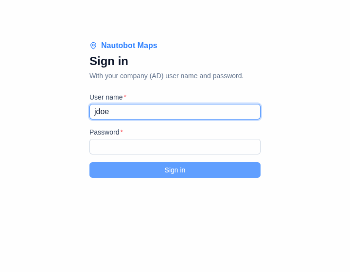

# Sign-in and roles

Who can open the app, and who can change things in it. The app has no login screen of its own: people sign in with your company's login (Entra ID, Keycloak, Okta, Google, GitLab…) through a **sign-in proxy** in front of it, and their groups give them a **role**.

## In short

**Pick one of three setups:**

| Setup | For | How |
|---|---|---|
| **No sign-in** (the default) | Trying it out, or a network only trusted people can reach | Nothing to do. Anyone who can reach it can look; changes are limited ([below](#without-sign-in-default)) |
| **The bundled proxy** (recommended) | Production: HTTPS and your company login, ready to use | A certificate and a few settings ([the bundled proxy](#the-bundled-proxy-https-and-company-sign-in)) |
| **Your own proxy** | You already have an SSO gateway | Point it at the app and pass the user and groups ([with a sign-in proxy](#with-a-sign-in-proxy)) |

**The roles:**

| Role | Can |
|---|---|
| **viewer** | Look: the map, the board, availability |
| **customer** (account managers) | Availability and each customer's status, read only; never a status link |
| **noc** | The wall view, the board, availability and maintenance (read only); acknowledge and add cases |
| **operator** (NWO) | Everything but administration: also maintenance, criticality, history, and customers' status links and their keys |
| **admin** | Everything: also API tokens, test notifications, the wireless check |

**Each role opens on its own pages** (#697), at its own address:

| Role | Opens on | Its pages |
|---|---|---|
| customer | `/customer` (Availability) | `/customer/tenants`: Customers, each opening its status |
| noc | `/noc` (the wall view) | `/noc/board`, `/noc/availability`, `/noc/maintenance` |
| operator (NWO) | `/nwo` (the map) | `/nwo/wall`, `/nwo/board`, `/nwo/availability`, `/nwo/maintenance`, `/nwo/circuits`, `/nwo/tenants` |
| viewer, admin | `/` (the map) | the usual addresses: `/alerts`, `/availability`, … (admins also `/admin`) |

**Which role for whom:** the NOC on duty → `noc` (or `operator` for those who also plan maintenance and send customers their links); account managers → `customer`; a wall screen → an [API token](#api-tokens) with role `noc`.

**Was DOV:** until 0.5.1 the `noc` role was called `dov`. The old names still work: `AUTH_DOV_GROUPS` (read when `AUTH_NOC_GROUPS` is empty; the log warns), `/dov…` addresses (they open `/noc…`) and `token create --role dov`; tokens made with role `dov` become `noc` when the app migrates its database at start. Rename `AUTH_DOV_GROUPS` to `AUTH_NOC_GROUPS` when you can.

**Scripts and tools** (LibreNMS, Alertmanager, MCP) use an [API token](#api-tokens) instead of a login.

## Without sign-in (default)

With `AUTH_MODE=disabled`:

- the map, the alert board and the read-only APIs are open to anyone who can reach the app;
- **cases and acknowledgements work for anyone who can reach the app**: adding a case number, acknowledging and **Remove ack** (the board needs them; `POST /api/v1/alert-cases`, `/api/v1/alert-acks` and `/api/v1/alert-acks/remove`). The board and its history then show no name for who did it (a script with an [API token](#api-tokens) shows as `token:<name>`);
- **changing criticality overrides, managing maintenance windows, sending test notifications and everything on the Admin page are refused** (403): they change what alarms for everyone, or send real messages to your channels. Set `ALLOW_UNAUTHENTICATED_WRITES=true` only if the app is reachable by trusted users alone; for scripts, an operator [API token](#api-tokens) is the safer way.

## With a sign-in proxy

Set `AUTH_MODE=header` and put the app behind a reverse proxy or SSO gateway that handles the login and passes the user and their groups in headers. The app ships one ready to use, nginx + oauth2-proxy ([the bundled proxy](#the-bundled-proxy-https-and-company-sign-in)); the settings below are what it needs in `.env` (#739), and what your own proxy needs.

```dotenv
AUTH_MODE=header
AUTH_HEADER_USER=X-Forwarded-User
AUTH_HEADER_GROUPS=X-Forwarded-Groups
AUTH_VIEWER_GROUPS=noc
AUTH_OPERATOR_GROUPS=nautobot-operators
AUTH_ADMIN_GROUPS=nautobot-admins
AUTH_NOC_GROUPS=noc-duty
AUTH_CUSTOMER_GROUPS=account-managers
```

### Roles

| Role | Can |
|---|---|
| `viewer` | Open the map, the board and the read APIs, when `AUTH_REQUIRE_VIEWER=true` (otherwise they are open to everyone) |
| `customer` | Availability (and its CSV) and each tenant's status in the app (`GET /api/v1/tenants/<tenant>/status`), read only; never a status link |
| `noc` | The wall view, the board with its history, availability and maintenance (read only); acknowledge, remove an acknowledgement, add cases |
| `operator` (NWO) | Everything but administration: also maintenance windows, criticality overrides, alert history, and customers' status page links (`/api/v1/status-links/…`) with their status tokens |
| `admin` | Everything an operator can, send test notifications (`POST /api/v1/notifications/test`), manage every API token, identities and roles (#721), and check the wireless controllers (`POST /api/v1/wireless/check`) |

A user has one role: the first of **admin, operator, noc, customer, viewer** that one of their groups gives, or `AUTH_DEFAULT_ROLE` when none does. Roles are never combined: someone in a viewer group and a customer group is a customer. Each role's permissions are one matrix in the app (`app/auth/permissions.py`), and every API route checks one of them. A permission is a **scope** such as `alerts:ack` or `status:links:view`; a role can hold `*` for any one part (`alerts:*` is every alerts permission, and the admin role holds `*`, `*:*` and `*:*:*`, so it gets new permissions at once). The roles and their scopes are kept in the app's database (#713): it starts with these five, and every worker reads them again within 30 seconds of a change. Admins change them on the Admin page or with `role ...` ([Changing roles](#changing-roles)). If the database's roles can't be read, the app keeps the last ones it read, or the five above. `python -m app roles` lists each role's permissions as the database has them.

The pages follow the role: the menu lists only the pages it can open, and each page shows only the buttons the role may use (#695). `GET /api/v1/me` and the pages' configuration say, in `access`, the role, its label, the page it opens on, its pages and its permissions (#693).

Customers, NOC and NWO each have their own addresses (`/customer`, `/noc`, `/nwo`, [above](#in-short); #697). Their menu links stay there, and the old addresses still work: a bookmark or a link such as `/alerts?tenant=Acme` opens the same page in the role's workspace, `/noc/board?tenant=Acme`. A page that isn't part of the role's workspace opens its start page, with a note. Viewers and admins keep the usual addresses. All of this is convenience only: every API route checks the permission itself.

See who gets what, from the running app:

```bash
docker compose exec api python -m app roles                      # every role, its permissions and groups
docker compose exec api python -m app roles --groups noc,kam      # the role a user in these groups gets
```

### Identities

An **identity** is a person the app knows by the user name the proxy sends (`X-Forwarded-User`; capitals don't matter), with one or more roles and, if needed, scopes of their own (#715). Someone with an identity gets every one of their roles' permissions and their own scopes. Their highest role (admin, operator, noc, customer, viewer) gives the label in the top bar and the page they open on. Their groups no longer matter.

**On the Admin page** (admins only, #721), **Identities** lists everyone with their roles, own scopes and keys; search by name, role or scope. **New identity** adds one (user name, display name, a first role). **Change** opens a row: give or take a role or a scope (a scope is checked as you type), or make a key with exactly that identity's rights, shown once. **Delete** asks first and says how many keys stop working. Identities made for one key (`token create --role`) are folded under "+N made for one API key".

Or from the command line:

```bash
docker compose exec api python -m app identity create jdoe --role admin --common-name "Jane Doe"
docker compose exec api python -m app identity add-role jdoe noc
docker compose exec api python -m app identity add-scope jdoe maintenance:write   # a scope of her own
docker compose exec api python -m app identity list
docker compose exec api python -m app identity delete jdoe
```

A change reaches the running app within 30 seconds. The same through the API (admin only): `GET`/`POST /api/v1/identities`, `DELETE /api/v1/identities/<name>`, `POST /api/v1/identities/<name>/roles` (`{"role": "noc"}`) and `/scopes` (`{"scope": "maintenance:write"}`), and `DELETE …/roles/<role>`, `…/scopes/<scope>`.

A change that would leave nobody an admin is refused: deleting the last identity with admin rights, or taking admin from them, says "make someone else an admin first". (Before anyone has an identity, the groups give admin, so this starts with the first identity that is an admin.)

**Without an identity**, `AUTH_GROUP_ROLES` decides:
- `true` (the default): the role their groups give, as above. The log says once per name `Signed in without an identity: 'jdoe' (role from groups: viewer)`, so you can see who still needs one.
- `false`: no access. Pages and the API answer "No access: ask an admin to add you".

**Moving to identities:**
1. Upgrade. Nothing changes yet: everyone keeps the role their groups give.
2. Find the user names people sign in with: the log lines above, or `username` in `/api/v1/me` (open it in the browser while signed in). With GitLab it is the GitLab user name or the email address, depending on oauth2-proxy's settings.
3. Create an identity for each person (at least one admin first).
4. Set `AUTH_GROUP_ROLES=false` and restart (`docker compose up -d`). From then on only people with an identity get in.

### Changing roles

What each role may do is its list of scopes (#721). On the Admin page, **Roles** lists each role, its scopes and how many identities have it. **Change** opens one: take a scope (its ✕), give scopes (several at once, by commas or spaces), or change its label, description and the page it opens on. **New role** makes one of your own; it always gets `session:basic` (the top bar and the help pages, which every signed-in role reads). Give it to people as an identity's role: the groups (`AUTH_*_GROUPS`) give only the five built-in roles.

- The five built-in roles can be changed but not deleted. A role of your own can be deleted: the identities that had it lose it (the page says how many first).
- A change that would leave no role with the `admin` permission is refused: taking `*` from `admin`, say (`admin` is a one-part scope, so `*` is the one that covers it; `*:*` and `*:*:*` can go).
- Every worker uses the change within 30 seconds; the one that made it at once.

```bash
docker compose exec api python -m app role list
docker compose exec api python -m app role create auditor --label Auditor --landing /noc --scope page:wall --scope alerts:history
docker compose exec api python -m app role add-scope auditor page:board
docker compose exec api python -m app role remove-scope noc alerts:case       # a built-in role too
docker compose exec api python -m app role update auditor --description "Reads the wall"
docker compose exec api python -m app role delete auditor
```

The same through the API (admin only): `GET`/`POST /api/v1/roles`, `PATCH`/`DELETE /api/v1/roles/<name>`, `POST /api/v1/roles/<name>/scopes` (`{"scope": "page:board"}`) and `DELETE …/scopes/<scope>`.

### Trusting only the proxy

The app trusts the identity headers only from the proxy: the direct peer must be in `AUTH_TRUSTED_PROXIES` (default: localhost only) and, if `AUTH_PROXY_SECRET` is set, send it in `X-Auth-Proxy-Secret`. Anything else is treated as anonymous and logged, so a client that reaches the app directly cannot claim to be an admin. The startup log shows which proxies are trusted.

With the proxy as another service in the same compose project, pin its address and trust that one:

```yaml
# docker-compose.override.yml
services:
  web:
    ports: !reset []          # only the proxy talks to the app
  my-proxy:                   # your proxy's service
    networks:
      default:
        ipv4_address: 172.30.0.10
networks:
  default:
    ipam:
      config:
        - subnet: 172.30.0.0/24
```

```dotenv
AUTH_MODE=header
AUTH_TRUSTED_PROXIES=172.30.0.10/32
AUTH_PROXY_SECRET=<long random string>
```

and in the proxy (nginx), the API's paths straight to `api` and the pages to `web` (#674): `web` would pass the API's paths on too, but then the API sees `web`'s address, not the proxy's. `/api/docs` is a page.

```nginx
location ~ ^/(api/(?!docs(/|$))|mcp(/|$)|healthz$|help/images/|docs(/|$)|openapi\.json$|static/) {
    proxy_pass http://api:5000;
    proxy_set_header X-Forwarded-User   $authenticated_user;   # from your SSO module
    proxy_set_header X-Forwarded-Groups $authenticated_groups;
    proxy_set_header X-Auth-Proxy-Secret "<the same secret>";
}
location / {
    proxy_pass http://web:3000;
}
```

Trust only the proxy's own address in `AUTH_TRUSTED_PROXIES` (pin it with `ipv4_address`, as `reverse-proxy/compose.yml` does), not the whole subnet, which includes `web`.

### The bundled proxy: HTTPS and company sign-in

Instead of setting up a proxy yourself, use the one in `reverse-proxy/`: **nginx** for HTTPS and **oauth2-proxy** for the login with any OIDC provider (Entra ID, Keycloak, Okta, Google).

1. **Register the app** with your identity provider. The redirect URL is `https://<your host>/oauth2/callback`, and the ID token must carry the user's groups (examples below).
2. **Certificates:** put `tls.cert` and `tls.privkey` in `reverse-proxy/certs/` (never committed, never in the image: mounted on `/etc/nginx/ssl`; from your CA: [your own certificate](#your-own-certificate)). To try it out, a self-signed one:
   ```sh
   openssl req -x509 -newkey rsa:2048 -nodes -days 30 -subj "/CN=maps.example.com" \
     -keyout reverse-proxy/certs/tls.privkey -out reverse-proxy/certs/tls.cert
   ```
3. **Settings** in `.env` (see `.env.example`, "HTTPS and sign-in"; every container reads it, #739):
   ```dotenv
   COMPOSE_FILE=docker-compose.yml:reverse-proxy/compose.yml
   PUBLIC_HOSTNAME=maps.example.com
   OIDC_ISSUER_URL=https://login.microsoftonline.com/<tenant-id>/v2.0
   OIDC_CLIENT_ID=...
   OAUTH2_PROXY_CLIENT_SECRET=...       # oauth2-proxy's own name for it
   OAUTH2_PROXY_COOKIE_SECRET=...       # 32 random bytes, base64 URL-safe
   AUTH_PROXY_SECRET=...                # openssl rand -hex 32
   # The API behind the proxy:
   AUTH_MODE=header
   AUTH_REQUIRE_VIEWER=true
   AUTH_TRUSTED_PROXIES=172.30.0.10/32  # PROXY_IP, /32
   AUTH_SIGN_OUT_URL=/oauth2/sign_out
   ```
   plus `AUTH_VIEWER_GROUPS` / `AUTH_OPERATOR_GROUPS` / `AUTH_ADMIN_GROUPS` with your provider's group names or IDs. The API refuses to start with `AUTH_PROXY_SECRET` but without `AUTH_MODE=header`; oauth2-proxy without its two secrets.
4. `docker compose up -d`, then open `https://<your host>`.

#### What it does

- **Port 80** only redirects to HTTPS, except `/healthz` for probes. **443** serves TLS 1.2 and 1.3 with HSTS. nginx listens on IPv6 too where the host has it, and on IPv4 only where it doesn't.
- **Every request** is checked with oauth2-proxy. Someone not signed in goes to your login page and comes back. The app gets the user (username, else e-mail) and groups as `X-Forwarded-User` / `X-Forwarded-Groups`, with `AUTH_PROXY_SECRET`. The top bar shows "olga · operator".
- **Without the company login:**
  - Requests with `Authorization: Bearer nmt_…` (API tokens: LibreNMS, Alertmanager, scripts, MCP). Matched on the header, not a path. The app checks the token.
  - The tenant [status page](status-page.md) and its files, because customers have no company login. The app checks their status token. Staff who are signed in are still recognised on the status page's data (`/api/v1/status/`): oauth2-proxy is asked, but only to pass on who is signed in, never to send anyone to the login. So a tenant's name on Availability opens its page for staff without a key, and a customer's key link works whether or not they are signed in.
  - `/healthz`.
  
  On these, nginx overwrites the identity headers (empty unless oauth2-proxy says who is signed in), so nobody can claim a user by sending them.
- **`/metrics`** is not served through the proxy. Prometheus scrapes the app inside the network.
- **The app:**
  - is no longer published on a host port;
  - trusts identity headers only from nginx's fixed address (`PROXY_IP`, default `172.30.0.10` on its own network `PROXY_SUBNET`; change both if that range is taken) and only with the secret;
  - runs with `AUTH_REQUIRE_VIEWER=true`.
- **The login** uses PKCE (`S256`), which Entra ID, Keycloak, Okta, Google and GitLab all accept.
- **Sessions** last 12 hours and are refreshed while in use. The identity provider is not asked on every request. The session cookie is `SameSite=Lax`, so a browser never sends it with a POST from another site.
- **Users in many groups** (Entra ID sends an ID of 36 characters each) are fine: nginx's header buffers are raised to 32 KB.

#### Entra ID (Azure AD)

- `OIDC_ISSUER_URL=https://login.microsoftonline.com/<tenant-id>/v2.0` and `OIDC_EMAIL_CLAIM=preferred_username`.
- In the app registration, under **Token configuration**, add the **groups** claim to the ID token. Groups then arrive as object IDs, so use those IDs in `AUTH_*_GROUPS`. Users in more than 200 groups get no list: assign groups to the application (Enterprise app, Users and groups) or use app roles.

#### Keycloak

- `OIDC_ISSUER_URL=https://keycloak.example.com/realms/<realm>`.
- Use a confidential client.
- Add a **Group Membership** mapper with the claim name `groups`, *Full group path* off, added to the ID token.

#### GitLab (self-managed or gitlab.com)

- Create the application under **Admin Area → Applications** (instance-wide) or a group's **Settings → Applications**: redirect URI `https://<your host>/oauth2/callback`, **Confidential** on, scopes `openid`, `profile` and `email`.
- `OIDC_ISSUER_URL=https://gitlab.example.com` (the GitLab address itself, no path), and its application ID and secret as `OIDC_CLIENT_ID` / `OAUTH2_PROXY_CLIENT_SECRET`.
- `OIDC_GROUPS_CLAIM=groups_direct`: the groups the user is a direct member of, as full paths such as `netops/noc`. Use those paths in `AUTH_*_GROUPS` (e.g. `AUTH_OPERATOR_GROUPS=netops/noc`). Membership through a parent group doesn't count: add the users to the group itself.
- `AUTH_DEFAULT_ROLE` (a role for everyone who signs in) is only safe on a self-managed GitLab whose accounts are your staff. **Never on gitlab.com**: anyone with a gitlab.com account can sign in to the application.
- A self-managed GitLab with a certificate from your company CA also needs `OIDC_CA_FILE` and `OAUTH2_PROXY_PROVIDER_CA_FILES` (below).

#### Company CA

oauth2-proxy checks the identity provider's certificate against the public CAs. A self-managed GitLab, an on-prem Keycloak or ADFS with a certificate from your company's own CA then stops it at start:

```
error while discovery OIDC configuration: ... tls: failed to verify certificate: x509: certificate signed by unknown authority
```

Give it that CA:

1. Get the CA certificate as a PEM file: the root (and any intermediate) CA from your IT, or the host's bundle if the host already trusts it (`/etc/ssl/certs/ca-certificates.crt` on Debian and Ubuntu, `/etc/pki/tls/certs/ca-bundle.crt` on RHEL). Put it next to the TLS certificate, e.g. `reverse-proxy/certs/company-ca.pem` (oauth2-proxy reads only a file: the one file setting left, #739).
2. Make it readable by all: `chmod 644 reverse-proxy/certs/company-ca.pem`. oauth2-proxy runs as a user of its own, and a CA certificate is public anyway.
3. In `.env`, both of these (the file on this host, and where oauth2-proxy finds it), then `docker compose up -d`:
   ```dotenv
   OIDC_CA_FILE=./reverse-proxy/certs/company-ca.pem
   OAUTH2_PROXY_PROVIDER_CA_FILES=/etc/oauth2-proxy/provider-ca.pem
   ```

It is trusted **together with** the public CAs, so a provider with a public certificate keeps working. A path that doesn't exist stops `docker compose up` with an error. The same CA for the app's own connections (Nautobot, LibreNMS, the domain controller) is `EXTRA_CA_PEM`, its text ([configuration](configuration.md#nautobot)).

Don't turn the certificate check off instead (`OAUTH2_PROXY_SSL_INSECURE_SKIP_VERIFY=true`): then anyone on the network who can answer for the identity provider's address can sign in as anyone, admin included.

#### Your own certificate

The self-signed certificate from step 2 is for trying it out. With one from your CA, replace the files in `reverse-proxy/certs/` (before #768 they were `fullchain.pem` and `privkey.pem`: rename them):

- `tls.cert`: the server certificate **first**, then the intermediate certificate(s), all PEM (`-----BEGIN CERTIFICATE-----`). From separate files: `cat server.crt intermediate.crt > reverse-proxy/certs/tls.cert`. A DER file (no `BEGIN` line) first: `openssl x509 -inform der -in server.cer -out server.crt`.
- `tls.privkey`: the private key, PEM. `chmod 600` it.
- `tls.password` (only for a key with a passphrase, e.g. XCA's "PEM encrypted" export): the passphrase, on one line. `chmod 600` it. Without this file the key must have no passphrase.
- From a `.pfx` / `.p12`: `openssl pkcs12 -in cert.pfx -nokeys -out reverse-proxy/certs/tls.cert` and `openssl pkcs12 -in cert.pfx -nocerts -nodes -out reverse-proxy/certs/tls.privkey` (add `-legacy` if OpenSSL 3 says "unsupported"); check the server certificate comes first.

Check before restarting:

```sh
# the key belongs to the certificate: the two lines are the same
openssl x509 -noout -pubkey -in reverse-proxy/certs/tls.cert | sha256sum
openssl pkey -pubout -in reverse-proxy/certs/tls.privkey | sha256sum   # with tls.password: -passin file:reverse-proxy/certs/tls.password
# the name is PUBLIC_HOSTNAME, and the dates
openssl x509 -noout -subject -ext subjectAltName -dates -in reverse-proxy/certs/tls.cert
```

Then `docker compose exec nginx nginx -t` and `docker compose restart nginx`: nginx reads the certificate only when it starts. `openssl s_client -connect <host>:443 -servername <host> </dev/null` should end in `Verify return code: 0 (ok)`; a browser that is happy while this complains means an intermediate is missing from `tls.cert`. Renewing is the same: replace the files and restart nginx.

#### HTTPS on another port

HTTPS must stay on port 443: the sign-in's redirect (`https://<PUBLIC_HOSTNAME>/oauth2/callback`) and nginx's HTTP→HTTPS redirect name no port. HTTP can move when port 80 is taken (`PROXY_HTTP_PORT=8080`); only the redirect from `http://` to `https://` is then lost.

### Signing out

**Sign out** in the ☰ menu is there for someone signed in through the proxy (not with an API token, and not with `AUTH_MODE=disabled`). It goes to `AUTH_SIGN_OUT_URL`; with your own proxy, set that to its sign-out address.

The bundled proxy sets it to `/oauth2/sign_out`: oauth2-proxy deletes its session cookie, then nginx sends the browser to `OIDC_LOGOUT_URL`, your identity provider's logout, so its session ends too.

Without `OIDC_LOGOUT_URL` you land on **"You are signed out"** (`/signed-out`, served by nginx without the login): going to the app instead would send you to the identity provider, which still has you signed in and would sign you straight back in. The page has **Sign in again** and says you are still signed in at the identity provider, with a link to it (`OIDC_ISSUER_URL`) to sign out there too.

| Provider | `OIDC_LOGOUT_URL` |
|---|---|
| Entra ID | `https://login.microsoftonline.com/<tenant-id>/oauth2/v2.0/logout?post_logout_redirect_uri=https://<your host>/` |
| Keycloak | `https://keycloak.example.com/realms/<realm>/protocol/openid-connect/logout?client_id=<client id>&post_logout_redirect_uri=https://<your host>/` |
| GitLab | none: GitLab has no logout address for other applications (sign-out there is a form, and its OpenID Connect has no `end_session_endpoint`). Leave it empty: Sign out ends the app's session and shows "You are signed out" with a link to GitLab, to sign out there too. Until then, **Sign in again** gets back in without a password |

- **Entra ID:** add `https://<your host>/` under the app registration's **Authentication → Redirect URIs** (Web) to come back to the app's sign-in; otherwise Entra ID still signs you out and stops at its own "You signed out" page.
- **Keycloak:** add `https://<your host>/` to the client's **Valid post logout redirect URIs**. Keycloak may ask "Do you want to log out?" first.

Ending the identity provider's session signs you out of it in that browser, as its own logout does: other web applications that use it (Outlook on the web, say) ask you to sign in again the next time they check with it.

### Changes from another site are refused

Behind any sign-in proxy, the browser's session cookie comes along with every request, so a page on another site could make a signed-in user send a change (a form posting to `/api/v1/maintenance/<id>/end`, say).

The app refuses any change (POST, PUT, PATCH, DELETE) that the browser marks as coming from another site (`Sec-Fetch-Site`, else `Origin`), with **403**. This works in every mode.
- The app's own pages are not affected.
- Scripts, webhooks and MCP clients send no such headers or use an API token, so they are not affected either.
- `/mcp` keeps its own rule (`MCP_ALLOWED_ORIGINS`).

With your own proxy, also set its session cookie to `SameSite=Lax`.

### Requiring sign-in everywhere

`AUTH_REQUIRE_VIEWER=true` makes every page and API need at least the `viewer` role, except `/healthz` and `/metrics` (probes and Prometheus send no identity; `/metrics` holds only counts). This includes a wall screen's browser and MCP clients: they sign in through the proxy, or with an API token.

## Sign-in with AD



The app can also sign people in itself, with their **Active Directory** user name and password on its own page, `/auth` (#717). It is off until `LDAP_URL` is set, and works beside the sign-in proxy: a request with the proxy's headers is still the proxy's user. Use it where there is no company sign-in in front of the app, or for people the proxy doesn't cover.

How it works:
1. The page sends the user name (`jdoe`, `DOMAIN\jdoe` or `jdoe@domain`) and password to `POST /api/v1/auth/login`.
2. The app finds the user with a **read-only service account**, then signs in to AD as them with their password, over LDAPS with the domain controller's certificate checked.
3. Only someone with an [identity](#identities) gets in ("No access" otherwise); a wrong password and an unknown user get the same answer. After 5 failed tries from one address the next has to wait 30 seconds, then longer each time.
4. The app answers with a signed token (JWT). The page keeps it as a cookie that scripts can't read (HttpOnly, Secure, SameSite=Strict); a script can send it as `Authorization: Bearer <token>`. `GET /api/v1/auth/verify` shows what's in it.
5. Every request reads the identity's roles again (within 30 seconds of a change), not from the token: taking a role away works at once, not when the token runs out. A token lasts `JWT_LIFETIME_SECONDS` (8 hours); then the page asks to sign in again.

**Sign out** in the top bar ends it (`POST /api/v1/auth/logout` removes the cookie). A token copied elsewhere stays valid until it runs out; changing `JWT_SIGNING_SECRET` ends every sign-in at once.

### Turning it on

```dotenv
AUTH_MODE=header                       # also without a sign-in proxy
AUTH_REQUIRE_VIEWER=true               # pages without sign-in go to /auth
LDAP_URL=ldaps://dc1.example.local     # ldaps:// only
LDAP_BASE_DN=DC=example,DC=local
LDAP_BIND_DN=svc-maps@example.local    # the read-only service account
LDAP_BIND_PASSWORD=...
EXTRA_CA_PEM=-----BEGIN CERTIFICATE-----\nMIID...   # the CA that signed the DC's certificate
JWT_SIGNING_SECRET=...                 # openssl rand -base64 48
```

- **Base DN:** your domain's parts: `example.local` is `DC=example,DC=local`. To look further down only, an OU: `OU=Staff,DC=example,DC=local`.
- **Service account:** an ordinary domain user with no rights beyond reading the directory (every domain user can). Its password goes in `.env`, never in the app's log.
- **The CA:** the domain controller's certificate is usually from your company CA; export it as PEM (the same one as for [Company CA](#company-ca)) and put its text in `EXTRA_CA_PEM` (#739: one line with `\n` for the line breaks, or `base64 -w0 company-ca.pem`). With it, LDAP trusts only that CA; without it, the public CAs. A certificate the CA didn't sign, or for another name, is refused.
- **The name in LDAP_URL** must be the one in the domain controller's certificate (not an IP address).
- **People sign in with** `sAMAccountName` by default (`LDAP_USER_ATTRIBUTE`); it is their identity's name: `python -m app identity create jdoe --role noc`.
- The app refuses to start with AD sign-in set up unsafely: `JWT_SIGNING_SECRET` shorter than 32 characters, `ldap://` instead of `ldaps://` (only `LDAP_ALLOW_PLAINTEXT=true`, for tests), or no `LDAP_BASE_DN`.

Check it: the startup log says `AD sign-in on: ldaps://… (base …)`; then open `/auth` and sign in. A wrong service-account password or an unreachable domain controller answers "The directory can't be reached" and is logged.

### With the bundled proxy

The bundled proxy can run without oauth2-proxy, with the app's own sign-in in its place (#723): HTTPS as before, but nginx asks no identity provider; it passes every request on with the identity headers empty, so nobody can claim a user by sending them, and the app asks for its sign-in (a page without it goes to `/auth`). API tokens and the tenant status page work as before. In `.env`, instead of the `OIDC_*` settings:

```dotenv
COMPOSE_FILE=docker-compose.yml:reverse-proxy/compose.app-sign-in.yml
PUBLIC_HOSTNAME=maps.example.com
AUTH_PROXY_SECRET=...                  # openssl rand -hex 32
LDAP_URL=ldaps://dc1.example.local
LDAP_BASE_DN=DC=example,DC=local
LDAP_BIND_DN=svc-maps@example.local
LDAP_BIND_PASSWORD=...
EXTRA_CA_PEM=...                       # the DC's CA, its text (above)
JWT_SIGNING_SECRET=...                 # openssl rand -base64 48
AUTH_MODE=header
AUTH_REQUIRE_VIEWER=true
AUTH_TRUSTED_PROXIES=172.30.0.10/32    # PROXY_IP, /32
```

then `docker compose up -d --build` (the proxy's image is built with `SIGN_IN=app`). The API refuses to start with `AUTH_PROXY_SECRET` but without `AUTH_MODE=header`, and with `LDAP_URL` but without `LDAP_BASE_DN` or a `JWT_SIGNING_SECRET` of 32 characters; without `LDAP_URL` nobody can sign in on `/auth`. Sign out is the app's own. To build the proxy's image yourself: `docker build --build-arg DOMAIN=… --build-arg SIGN_IN=app reverse-proxy` (the default, `SIGN_IN=oauth2-proxy`, is the company sign-in above). Going back is setting `COMPOSE_FILE` to `reverse-proxy/compose.yml` again.

## API tokens

Scripts, LibreNMS and MCP clients that can't log in through SSO use a named **API token** (a key), optionally with an expiry:

```
Authorization: Bearer nmt_...
X-API-KEY: nmt_...                 # the same, as the header some tools prefer
```

**A key belongs to an [identity](#identities)** and has exactly its rights: the identity's roles and own scopes, read as they are now (#719). Take a role from the identity and its keys lose it too (within 30 seconds); delete the identity and its keys stop working.
- `token create librenms --role operator` makes an identity of the key's own, `librenms`, with that role, and its key. That is how keys were made before, and still are for scripts.
- `token create jdoe-script --identity jdoe` makes a key for an existing identity, with exactly jdoe's rights.
- `token list` and the Admin page show each key's identity. Purging a key's last revoked token also removes the identity made for it; a person's identity is never removed that way.
- **Upgrading:** every token made before has been given an identity of its own, named after it (lowercase, spaces as dashes; `-key` added if a person had the name), with the token's role. The keys didn't change: nothing needs to be sent out again.

- It works with `AUTH_MODE=disabled` and `header`, from any address (the token is the secret; `AUTH_TRUSTED_PROXIES` doesn't apply). With `disabled`, an operator token can make changes without `ALLOW_UNAUTHENTICATED_WRITES`.
- Changes made with it are recorded as `token:<name>` (e.g. on cases and maintenance windows).
- A wrong, expired or revoked token gets **401** on every request except `/healthz` and `/metrics` (always public), so a script notices.
- Only the token's SHA-256 is stored. The token itself is shown once, when it is created.
- A token with role `status` belongs to one tenant and opens only that tenant's [status page](status-page.md) (403 everywhere else). Create it with `--role status --tenant "Acme Corp"` or `{"role": "status", "tenant": "Acme Corp"}`. It can carry the customer's addresses for [alarm mails](notifications.md#customers) (`--notify-email`, `"notify_email"`); to change them, revoke it and make a new one.
- Other `Bearer` values (not starting with `nmt_`, e.g. an access token your proxy forwards) are ignored; sign-in then works as without a token.

### Creating and revoking

On the command line (this is how the first admin token is made):

```sh
docker compose exec api python -m app token create librenms --role operator --expires-days 365
docker compose exec api python -m app token create wall-screen --role noc   # also customer; nwo = operator
docker compose exec api python -m app token list
docker compose exec api python -m app token revoke 3
docker compose exec api python -m app token purge --older-than 90 --dry-run
```

On the **Admin** page (☰ → **Admin**, only for admins) the same without a command line: the active tokens newest first (a search past 25), **New token** (name, role, for a status token its tenant picked from Nautobot's and its optional notification email, and how long it works) shows the key once with **Copy**, **Revoke** per row (asks once more), and "+N revoked or expired" opens them, with **Purge**. With `AUTH_MODE=disabled` the page is there only with `ALLOW_UNAUTHENTICATED_WRITES=true`, as the routes it uses.

`token list` shows the tokens that work, then "+N revoked or expired (--all to show)"; `--all` lists those too, and `--tenant "Acme Corp"` only that tenant's status tokens.

A revoked or expired token stays in the list with its name, for the audit trail: changes made with it are recorded as `token:<name>`, and a name can't be used twice. `token purge` deletes revoked and expired tokens for good, never an active one; `--older-than DAYS` only those that stopped working more than DAYS ago, so a recent revocation stays visible a while; `--dry-run` lists what would go and deletes nothing. Each purge is logged (`API token 'x' purged by cli`), and the names are free again. Nothing else refers to a token's record: cases and maintenance windows keep their `token:<name>` text, only the token's own record (when it was made and revoked) is gone.

Or through the API (admin role; also on the API page, `/api/docs`): `POST /api/v1/tokens` with `{"name": "librenms", "role": "operator", "expires_in_days": 365}` returns the token once; `GET /api/v1/tokens` lists the active ones (name, first characters, role, expiry, last use, state; never the secret) and `inactive`, how many are revoked or expired, `?all=true` lists those too and `?tenant=Acme%20Corp` only that tenant's; `POST /api/v1/tokens/<id>/revoke` revokes one from the next request on; `POST /api/v1/tokens/purge` with `{"older_than_days": 90, "dry_run": true}` (both optional) answers the tokens it deleted, or would delete.

### Behind a sign-in proxy

The request must reach the app with its `Authorization` header. If the proxy requires SSO on every path, let requests with a token past it, e.g. oauth2-proxy's `--skip-auth-route` for the API paths your scripts use (`--skip-jwt-bearer-tokens` doesn't help: these tokens are not JWTs). The app checks the token itself.

A path-based skip also lets requests **without** a token past SSO. Set `AUTH_REQUIRE_VIEWER=true` with it, so those get 401 instead of the read APIs that are otherwise open to everyone (or skip SSO only for requests that carry `Authorization: Bearer nmt_`, if your proxy can match on headers).

On routes the proxy doesn't authenticate, it must still **remove or overwrite** `X-Forwarded-User` and `X-Forwarded-Groups` from the client (nginx: `proxy_set_header X-Forwarded-User "";`). Otherwise a client without a token could send them through the trusted proxy and claim any user.
