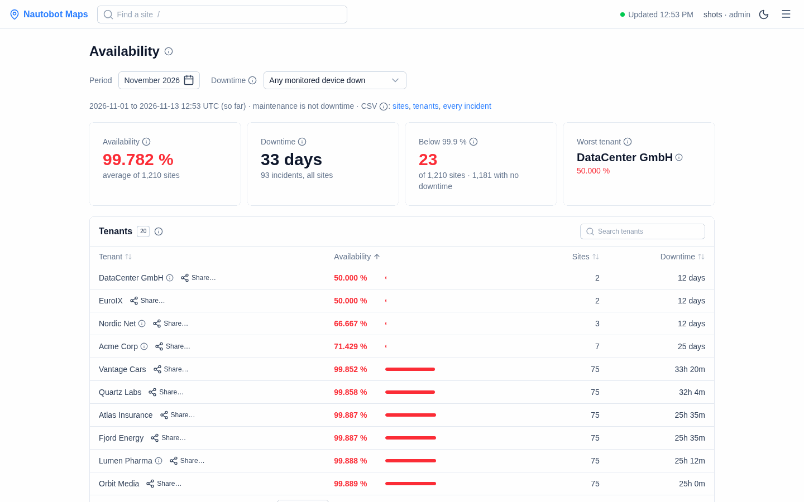

# Availability

**Availability** (☰ menu, `/availability`) answers "what was the uptime?": for every site and every customer, over a month or any days you choose. Use it for monthly customer reports and to check an SLA.

- **[Using it](#using-it)**: choosing a period, reading the figures, downloading a spreadsheet.
- **[Setting it up](#setting-it-up)**: the target and what counts as downtime.
- **[Details](#details)**: how the figures are calculated, the API and the CSV columns.

## Using it

### Choosing a period

Click **Period**, then either:
- a quick choice: **This month**, **Last month**, **Last 7 days**, **Last 30 days**; or
- the first and the last day on the calendar (‹ › change the month).

The keyboard works too: arrows move a day or a week, Page Up/Down a month, Enter picks, Escape closes.

### Reading the page

- **Four cards** at the top: the availability (the average of the sites), the total downtime and number of incidents, how many sites are below the target (and how many had no downtime), and the worst customer.
- **Customers** (tenants) and **sites** below, the worst first. Each has a bar: **green** at the target or above, **red** below. Downtime is shown as on the board ("2h 14m", "3 days").
- **Devices** says how much is at a site: "12 network · 40 APs".
- **Search** for a site or customer, or pick a customer. Click a column to sort by it.
- **The (i)** next to the title, each card and each list explains what it means.
- **A customer's name** opens their [status page](status-page.md) in a new tab. Admins see **Share…** next to it, to make the link you send the customer ([how](status-page.md#sending-a-customer-their-link)).

### What counts as downtime

- **By default:** the time **any** monitored device at the site was down. Devices down at the same time count once. Access points that a wireless controller watches are left out.
- **Or:** only the time the site was **Critical**. Switch with **Downtime** on the page. This follows the site's level, so an access point marked critical that made the site Critical counts here.
- **Never:** planned maintenance.

### Downloading a spreadsheet

The **CSV** links give three files, each starting with a header saying what it covers:
- **Sites**: each site's availability, downtime, outages and details.
- **Tenants**: each customer's availability and downtime.
- **Incidents**: every time a device was down, to check the figures.

## Setting it up

| You want… | Setting |
|---|---|
| Another target (SLA) than 99.9 % | `AVAILABILITY_TARGET_PCT=99.5` |
| Downtime = time at Critical, by default | `AVAILABILITY_BASIS=critical` |
| A longer history | `ALERT_HISTORY_RETENTION_DAYS` (default 730, two years) |

It needs the database, and the access points it counts apart are the roles in `ACCESS_POINT_ROLES` ([what to set in Nautobot](nautobot-setup.md#access-points)).

## Details

### How it is calculated

- **The period** is a month or any days you choose, at most 366. Days in the future, and days older than the history kept, can't be chosen. Both days are included; a period that hasn't ended runs up to now ("so far").
- **Availability** = 1 − downtime ÷ the period, in UTC.
- **Downtime** is set with `AVAILABILITY_BASIS`, or with **Downtime** on the page:
  - `any_down` (default): the time **any** monitored device of the site was down, from the incident history. Devices down at the same time count once. Access points a [wireless controller](alert-board.md#access-points) watches are left out: at 10,000 they would turn every site red; they stay in each site's History.
  - `critical`: the time the site was at **Critical**, from its recorded level changes. A site's level before its first recorded change is the one that change came from; a site that has never changed level counts from when it was first seen.
- **Maintenance windows are not downtime.** A site window removes its time from the site, and a device window from that device. A window ended early counts until it ended; a cancelled one doesn't count.
- **A tenant's availability** is the average of its sites' availability (each site counts the same), with the number of sites.
- **Left out:** sites without monitored devices, unless their history has incidents in the period.
- **Below the target** (`AVAILABILITY_TARGET_PCT`, default 99.9 %) is red. The bars run from 98 % (or 1 point below a lower target) to 100 %.
- **Devices** counts the monitored devices, those in maintenance too; access points are the device roles in `ACCESS_POINT_ROLES`, everything else is network equipment.
- **Lists:** the worst 25 sites and 10 tenants are shown, then **Show 25 more** or **Show all**, with how many of the rest had no downtime. With more than 10 tenants, the Tenants table has its own search, by name or description. A tenant with a description in Nautobot has an **(i)**, as on the board.

The figures add up with the history: in `any_down`, a site's downtime is the incidents CSV's down periods for the period, overlaps counted once, minus maintenance.

History older than `ALERT_HISTORY_RETENTION_DAYS` is deleted: a period that starts before that is refused, rather than shown with its deleted outages missing.

### API and CSV

Both are readable like the board: with `AUTH_REQUIRE_VIEWER=true`, the viewer role.

- `GET /api/availability?month=2026-10&basis=any_down`, or `?from=2026-10-03&to=2026-10-09` for any days (both included): the report as JSON (`sites`, `tenants`, `period` with `from`, `to` and `label`, `summary` with the cards' figures, and `tenant_descriptions`). A from–to that is a whole calendar month (the 1st to its last day) is that month; otherwise `month` is `null`.
- `GET /api/availability.csv?month=2026-10&view=sites` (or `view=tenants` or `view=incidents`; `from` and `to` work here too): for a spreadsheet. Downtime is in minutes; times are UTC. `month` is empty unless the period is a whole month. The page's **CSV** links are these three, each with the report header.
  - **Sites**: the site, tenants, availability, downtime and incidents; `period_from` and `period_to`; then the site's details and outages: `site_path`, `address`, `country`, `tier`, `monitored_devices`; `outages` (down time merged after maintenance, so devices down together are one outage), `longest_outage_min`, `mean_time_to_restore_min` (the mean outage), `first_outage_utc`, `last_outage_utc`; `maintenance_min` (time in a whole-site window, not counted as downtime); `site_id`; then `network_devices` and `access_points`.
  - **Tenants**: the tenant, sites, availability and downtime, and the period.
  - **Incidents**: one row per device incident in the period, to check the figures: `site`, `site_path`, `tenants`, `device`, `down_at_utc`, `up_at_utc` (empty while still down), `minutes_in_period`, `minutes_counted` (after maintenance), `maintenance` (`none`, `partly` or `full`), `cases` (separated by `;`), `probable_cause`, `site_id`, `device_id`. With the `critical` basis the incidents are listed the same way; the site's downtime is then its time at Critical.
  - `header=1` puts the report's header above the table: the period, basis, target, when it was made and by whom, the sites, availability, downtime, incidents, sites below target and with no downtime, the worst tenant; then a blank line. Without it the file starts with the table, as older versions did, so scripts keep working.
