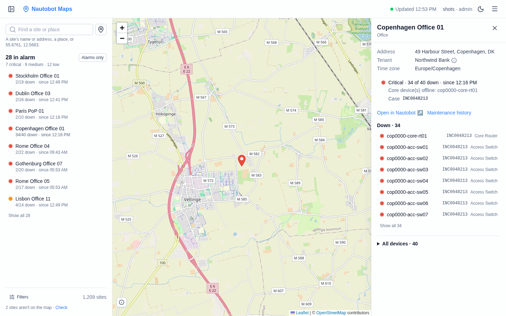
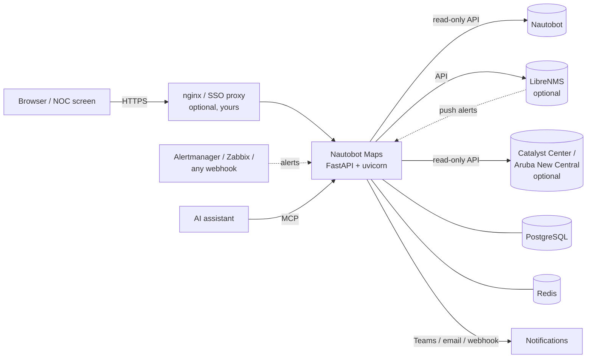

# How Nautobot Maps works

An overview for anyone new to the app: what it does, the pages, and what it can and can't do. Then, for the technical reader, what it is made of, how data flows through it and how it is set up. The other guides go into detail; this one links to them.

## In one paragraph

Nautobot Maps reads your sites and devices from **Nautobot** (it never changes anything there), asks **LibreNMS**, **Prometheus Alertmanager**, any webhook and your **wireless controllers** which devices and access points are down, and shows the result as a **map**, an **alert board** for the NOC, a **wall view** for a screen, **availability** reports, **maintenance** planning and a **status page** per customer. It keeps its own history (outages, cases, acknowledgements, maintenance) and sends **notifications** when a site goes into alarm or recovers.

## For everyone

### The pages

| Page | Where | For |
|---|---|---|
| **Map** | ☰ → Map (`/`) | Every site with coordinates, coloured by how bad things are; sites in alarm always stand out. Click a site for its devices, ASNs and circuits |
| **Alert board** | ☰ → Alert Board (`/alerts`) | The NOC's work list: sites in alarm, down devices, since when, cases, acknowledgements, maintenance, history ([guide](alert-board.md)) |
| **Wall view** | ☰ → Wall view | A screen nobody clicks on: alarms only, "NO CASE" stands out, a loud warning when it stops updating ([guide](alert-board.md#the-wall-view-noc-screen)) |
| **Availability** | ☰ → Availability | Uptime per site and customer for any period, planned maintenance not counted; spreadsheets ([guide](availability.md)) |
| **Circuits** | ☰ → Circuits | Circuits not yet linked to a site in Nautobot, and the site their address points to ([circuit mapping](#circuit-mapping)) |
| **Maintenance** | ☰ → Maintenance | Plan maintenance for many sites or devices at once, see and end it, history ([guide](alert-board.md#maintenance-windows)) |
| **Status page** | A private link per customer | "Are we affected?" for one customer ([guide](status-page.md)) |
| **Admin** | ☰ → Admin *(admins only)* | API tokens, a test notification, a check of the wireless controllers |
| **Documentation** | ☰ → Documentation (`/help`) | These guides |
| **API** | ☰ → API (`/api/docs`) | Every API endpoint, with **Try it out** |

### The top bar

Every staff page has the same slim bar at the top:

- **Nautobot Maps** (back to the map) and **Find a site**: type a few letters of a site's name, path or address, then pick it to open it on the map, or **Board** to see it on the alert board. `/` jumps there from anywhere. The map leaves it out, because its own search also finds places.
- **How fresh the data is:** a quiet dot and "Updated 14:05". It turns **amber** ("LibreNMS data is 45 min old") when a sync is late, and **red** ("Can't reach LibreNMS") when the last sync failed. Click it for each source.
- **Who is signed in** ("olga · operator", or a token's name). **Sign out** is in the ☰ menu when you signed in through a sign-in proxy.
- The **theme** button (dark or light) and the **☰** menu with every page.

The wall view and the status page have no bar. The status page is for customers, so it has no staff names, search or menu.

### The site panel

Click a site on the map (or in the map's list) and a panel opens on the right, with what is wrong first:



- **At the top:** the site's name, type and path; its basic info (address, customer with its (i), customer group, facility, time zone, tags, description: the ones it has); **one status line** ("Critical · 34 of 40 down · since 14:05", with the reason under it, or "OK · 40 devices"); and **who is on it**: its case numbers, and in red how many down devices nobody has picked up yet (**No case**, or "29 without a case"). Then links to Nautobot and to the maintenance history.
- **The down devices**, the likely cause first, eight at a time with **Show all**. Each line: status, name, its case, role. A device in maintenance, within the alert delay or not monitored says so. A down access point says which switch and port it is on: "Connected to sw-acc01 · Gi1/0/12".
- **Click a device** for its model, IP, software, serial and customer.
- **Folded below:** **All devices**, **Circuits** and **ASNs**, each with its count.

More: [the site panel in detail](#the-site-panel-in-detail).

### What it can and can't do

**Can**
- Show every site on a map and on a board, with a level that means the same everywhere.
- Combine status from Nautobot, LibreNMS, Alertmanager, any webhook and the wireless controllers' access points.
- Track who is on an alarm (case numbers, acknowledgements) and link cases to your ticket system.
- Plan maintenance so planned work is not an alarm, and leave it out of availability.
- Report availability per site and customer for any period, with spreadsheets that add up.
- Notify Teams, email or a webhook, summarised during a wide outage.
- Give each customer a status page; give AI assistants access through MCP.

**Can't (by design or not yet)**
- **Change Nautobot.** It only reads: fix a site, device or IP in Nautobot, not here ([what to set](nautobot-setup.md)).
- **Monitor devices itself.** It doesn't ping or poll SNMP; it relies on Nautobot's status, LibreNMS, Alertmanager or webhooks.
- **Keep its own user accounts** or passwords: people sign in with your company's identity provider, through the bundled proxy or yours, which also serves HTTPS.
- **Create tickets in your ticket system.** It stores case numbers and links to them; it doesn't open or close tickets.
- **Show sites without coordinates on the map** (they are still on the board).
- **Know the whole cabling.** "Likely caused by the core router" is a guess from device roles, not from topology. Only access points know their switch and port, from Catalyst Center or Nautobot's cables.
- **Keep history forever by default.** Resolved history older than `ALERT_HISTORY_RETENTION_DAYS` (two years) is deleted; availability can't go back further.

### Built for a large network

The app is designed for **1,200+ sites and 10,000+ devices**, with 20–30 sites and 50–100 devices down on a normal day:

- Lists show the worst first and fold the rest ("+N more"); handled and maintenance sites sit quieter, below.
- Bulk actions: a case or acknowledgement for many devices, maintenance for many sites or a whole customer.
- Notifications are summarised during a wide outage.
- No per-site requests or queries; Nautobot answers are cached in Redis; large answers are compressed (the board's data at 1,200 sites goes from about 1.3 MB to a tenth).

## For the technical reader

### The building blocks

| Part | What it is | Why |
|---|---|---|
| **Python 3.13 + FastAPI** | The web app: pages, the JSON API, webhooks, MCP; typed requests and the OpenAPI spec behind `/api/docs` | Small, well-known, enough for this load |
| **gunicorn** | The production web server inside the container: 4 uvicorn worker processes by default (`GUNICORN_WORKERS`) | Several requests at once; a stuck one can't block the rest |
| **PostgreSQL 16** | The app's own database: a copy of the inventory, alert history, cases, acks, maintenance windows, notifications queue, API tokens | History survives restarts; one source of truth for every worker |
| **Redis 7** | Shared cache of Nautobot answers and rate limits between workers | Fewer calls to Nautobot; every worker sees the same cache |
| **Leaflet** (+ markercluster) | The map in the browser, bundled into the Nuxt build (`web/`) | No CDN needed at runtime |
| **OpenStreetMap** tiles and **Nominatim** address search | Map background and "search by address" (both replaceable: `MAP_TILE_URL`, `GEOCODER_URL`, or off) | Free defaults; point them at your own servers if needed |
| **Nuxt (Vue, TypeScript) + Nuxt UI** | Every page: `web/`, built to static files the app serves; the API page is Swagger UI inside it | The team's standard; typed from the API's own models; no Node in production; strict Content Security Policy |
| **Docker / Docker Compose** | Packages the app with PostgreSQL and Redis (`docker-compose.yml`) | One command to start |
| **nginx + oauth2-proxy** *(optional, bundled in `deploy/proxy/`)* | In front of the app for HTTPS and company sign-in (any OIDC provider), or your own SSO proxy instead | The app has no login screen of its own and doesn't do TLS: your identity provider signs people in |

The app listens on port 5000 (in Compose, only on `127.0.0.1:5000` of the host). In production you put your proxy in front of it.



### How the data flows

1. **Sync from Nautobot.** A background scheduler (one thread per worker; a PostgreSQL lock lets only one work at a time) fetches locations, devices, ASNs, circuits and cables from Nautobot every `INVENTORY_SYNC_INTERVAL_SECONDS` (default 300 s). Syncs are incremental (only what changed); once a day a full sync removes deleted objects. The result is stored in PostgreSQL.
2. **Who is down.** A device's status comes from Nautobot and, when configured, LibreNMS (polled, and pushed within seconds by LibreNMS alert rules). Alertmanager and a generic webhook can also mark devices down ([other sources](sources.md)). Alerts are matched to Nautobot devices by name or primary IP. Wireless controllers (Cisco Catalyst Center and Aruba New Central, any number of each) say which access points are down and their address, matched by serial or name: those are monitored without a primary IP, and a site with only access points down is under the board's Wireless chip, not an alarm. Catalyst Center also says which access points are still onboarding with Plug and Play and which switch port each one is on.
3. **Build the board.** Only **monitored** devices count: those with a primary IP or a wireless controller, after exclusions. Each site gets a level: **Critical** (a core device down, or all devices down), **Medium** (over 25 % down), **Low** (one or more down), **OK** or **No data** ([alert levels](alert-board.md#alert-levels)). Maintenance windows, an alert delay and flapping detection keep noise off the board.
4. **Record history.** Every outage, level change, case and acknowledgement is stored, so history and availability are complete even when nobody has a page open.
5. **Notify.** When a site reaches the notify level (Critical by default) or recovers, a message goes to Teams, email or a webhook. During a large outage many changes are sent as one summary, not one message per site ([notifications](notifications.md)).
6. **Show.** The browser pages call the app's JSON API and update themselves. Large answers are gzipped.

The top bar's freshness dot reads what the scheduler records once a minute (`GET /api/v1/app-status`) and never calls Nautobot or LibreNMS itself. "Late" is three sync intervals, at least 15 minutes.

### Addresses

| Page | Address |
|---|---|
| Map | `/` |
| Alert board | `/alerts` |
| Wall view | `/alerts?view=wall` |
| Availability | `/availability` |
| Circuits | `/circuits` |
| Maintenance | `/maintenance` |
| Tenant status | `/status/<id>` (a random link per tenant) |
| Admin | `/admin` *(admins only)* |
| Documentation | `/help` |
| API | `/api/docs`, the OpenAPI spec at `/api/openapi.json`. The old `/docs` and `/openapi.json` redirect there for good (301) |
| Health / metrics | `/healthz` (liveness probe), `/metrics` (Prometheus) |
| MCP | `/mcp` *(off by default)*: AI assistants read the board and add cases |

### The site panel in detail

**Who is on it:** "Case INC0048213" (each a link to your ticket system with `CASE_URL_TEMPLATE`; the first three, "+N" for more), and in red how many down devices are waiting for someone (no case and no acknowledgement; not one in maintenance or within the alert delay): **No case** when none has one, "29 without a case" when some do (a core outage with one old case still needs someone). Without the database (map only) it says nothing rather than a false "No case".

**The down devices:** core devices first (the likely cause), then those set Critical or Medium in Nautobot, eight at a time with **Show all**. An access point still onboarding says "Onboarding (PnP: Unclaimed)".

**A stack** (a Nautobot virtual chassis) is one device: its master's row says "Stack of 4" and opens to list the other members (place, name, model, serial). Members often have no name in Nautobot: they are called by their stack and place ("sw-stack01:2"), never "Unknown". An IP on any member is the stack's, and when any of them doesn't answer, the whole stack is down. It counts once, as its lead (its master, else its first member), on the board, the map and here: the stack's row is red, and its details say "The whole stack is down, all its members". A member's own status never shows. A filter or search shows a stack whole when any of its devices matches. The count reads "All devices · 12 (3 in stacks)". Renaming a stack or moving its master in Nautobot makes the next sync a full one.

**The folds:** **All devices** (open for a healthy site with ten or fewer; filters and a search from eleven devices), **Circuits** and **ASNs**, each left out when empty. A fold stays as you left it while the panel refreshes.

### Circuits in the site panel

The site panel lists a site's circuits in two ways:

- **Terminated there**: a circuit termination in Nautobot at the location. This is the proper link.
- **By address**: a circuit **without a termination at any location** whose **description is the site's physical address**. They are marked *By address*, after the terminated ones. Once a circuit has a termination (at this site, one of its buildings or anywhere else), it is no longer matched by address.

Addresses written as *street number, postcode town* match by **street, number and postcode**: `Roersvej 33, 5000 Odense C`, `Roersvej 33, 5000 Odense` and `Roersvej 33 st. tv, 5000 Odense` are the same; the town, a floor and door (`st. tv`, `2. th`) and a country don't count, and `33A` is `33 A` but not `33`. A full address in another form (`1 Canada Square, London E14 5AB`), or a description with more than the address (`Fibre 1G – Roersvej 33, …`), only matches exactly the same text. Anything shorter, such as a town or a street without a postcode, is never matched. When the address belongs to more than one site, the card says *address shared with N other sites* (a site's own buildings at the same address don't count). If the site's terminations can't be read from Nautobot, the panel says so and lists no circuits by address either.

Circuits are read from Nautobot in full with every inventory sync, so a new termination counts at the next sync (one request for a few hundred circuits; nothing per site). They and each location's address key are stored, so opening a panel is two indexed database lookups. Nautobot without the circuits app is simply no circuits. To link a circuit for good, add a termination at the location in Nautobot.

### Circuit mapping

**Circuits** in the ☰ menu (`/circuits`) is the worklist for adding those terminations: every circuit without a termination at a location (Decommissioned ones left out), grouped by what its description's address found, worst first:

1. **Several sites**: the address belongs to more than one site; someone chooses where to terminate it.
2. **No site**: the description isn't an address of any site (more text, another form, an address no location has, or none).
3. **One site**: ready; add the termination at that site.

The groups start folded, with their counts; each shows 100 circuits at a time. The search looks in the circuit, provider, type, status, tenant, description and sites. A circuit links to it in Nautobot, a site to its panel on the map (a site without coordinates through a building of it at the address, else to the site in Nautobot). **Download CSV** (`/api/v1/circuit-mapping.csv`) has every circuit with its group, commit rate, suggested sites and Nautobot id, for bulk work in Nautobot; the JSON is `/api/v1/circuit-mapping`. It reads the stored circuits and locations (two queries, nothing asked of Nautobot), so a circuit leaves the list at the next sync after it gets a termination. Viewers and up, like the board.

### Setup

#### Quick start (demo, no Nautobot needed)

```bash
docker compose -f demo/docker-compose.yml up --build
# → http://localhost:5000
```

#### Real install

You need Docker and a Nautobot 2.x or 3.x API token (read-only is enough).

```bash
git clone https://github.com/Jackass4life/Nautobot-maps.git
cd Nautobot-maps
cp .env.example .env    # set NAUTOBOT_URL, NAUTOBOT_TOKEN and POSTGRES_PASSWORD
docker compose up --build -d
```

This starts three containers: `nautobot-maps` (the app), `postgres` and `redis`. On start the app migrates the database, then runs gunicorn. Everything is configured with environment variables in `.env` ([every setting](configuration.md)); files it reads (wireless controllers, criticality rules, CA certificates) go in `config/`, mounted read-only at `/config` and readable by the app's group 10001 ([config/README.md](../config/README.md)). Use `docker compose up`, not `build && start`.

Then fill in Nautobot: [what to set in Nautobot and LibreNMS](nautobot-setup.md).

#### Production checklist

- Run a **released image**, not a local build ([operations](operations.md#run-a-released-version)).
- Put **HTTPS and sign-in** in front: the bundled nginx + oauth2-proxy (`COMPOSE_FILE=docker-compose.yml:deploy/proxy/compose.yml` and six settings), or your own SSO proxy with `AUTH_MODE=header`. Roles are **viewer**, **operator** and **admin**, from your groups ([sign-in and roles](authentication.md)). The app trusts identity headers only from the proxy (`AUTH_TRUSTED_PROXIES`, `AUTH_PROXY_SECRET`).
- Set your own `POSTGRES_PASSWORD` **before the first start**, and back up the database ([backup and restore](operations.md#backup-and-restore)).
- Optional: LibreNMS (`LIBRENMS_URL`, `LIBRENMS_API_TOKEN`), wireless controllers (`config/wireless.yml`, `WIRELESS_CONTROLLERS_FILE`; check with `wireless-check`), customer status pages (a link per tenant, from **Share…** on Availability), notifications (`NOTIFY_*`, `SMTP_*`), case links to your ticket system (`CASE_URL_TEMPLATE`), one row per Site (`ALERT_BOARD_SITE_LOCATION_TYPE`), importance tiers (`SITE_TIER_FIELD`), tenant role scopes on status pages (`TENANT_SCOPE_FIELD`), device and site criticality from Nautobot (`DEVICE_CRITICALITY_FIELD`, `TIER_DEVICE_LEVEL`).
- Monitor `/healthz` and scrape `/metrics` ([monitoring](operations.md#monitoring)).
- API tokens for scripts, Alertmanager and MCP: `docker compose exec nautobot-maps python -m app token create <name> --role operator`.

### The code, briefly

- `api/`: the app (FastAPI, `app/main.py`; uv). `app/services/`: one module per job (`inventory_service` sync, `alerts_service` board rules, `maintenance_service`, `availability_service`, `notify_service`, `webhooks_service`, `token_service`, `wireless_service`, `mcp_service`, `guide_service` for these pages…), `app/clients/` the Nautobot, LibreNMS, Catalyst Center and New Central clients. The routes are in `app/v1/routes/`, one file per area, under `/api/v1`, with their answers' models in `app/v1/answers/`; `app/v1/deps.py` holds the sign-in check, `app/frontend/` the pages' files and the security headers. The board's database reads and writes are in `app/repositories/board_repository.py`; the schema is Alembic's (`api/alembic/`).
- `web/`: the pages, on Nuxt, built with `npm run generate`; the API serves the build (`api/app/frontend/`), its files under `/_nuxt/`. They call the API only through the typed client generated from `api/openapi.json`.
- `api/tests/` (pytest, about 1,350 tests), `web/tests/` (Vitest for the pages' logic) and `e2e/` (Playwright in Chromium). CI runs lint, the tests on Python 3.13, a real Nautobot, a Docker smoke test, the bundled sign-in proxy with real nginx, a dependency audit and CodeQL.
- Development setup: [CONTRIBUTING.md](../CONTRIBUTING.md).
