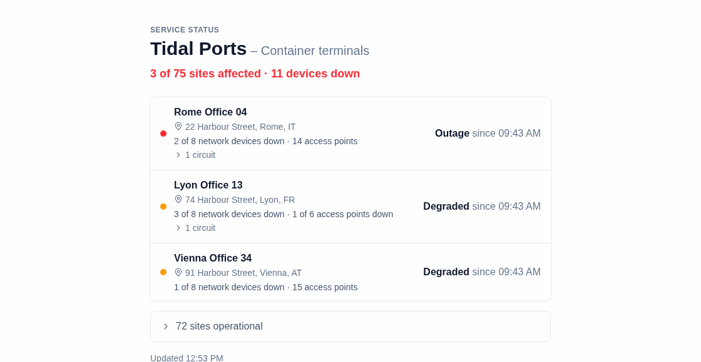

# Tenant status page

A **status page** answers one question for one customer: "are we affected?". It lists that customer's sites and whether each one works, without showing the rest of the network. You send the customer a private link, and they can open it any time.

- **[Using it](#using-it)**: what the customer sees, and how to send a link.
- **[Setting it up](#setting-it-up)**: what it needs from Nautobot and the app.
- **[Details](#details)**: the exact rules, access, the sign-in proxy and the API.

## Using it

### What the customer sees



- **At the top:** the customer's name, with their description from Nautobot ("Acme Corp – Retail bank, 24/7"), and one line for everything: "All 5 sites operational", or "2 of 5 sites affected · 4 devices down".
- **Each site**, the worst first:
  - its **state** and since when (see the table below);
  - its **description** from Nautobot, when it has one ("Primary Scandinavian data centre");
  - **where it is**: the address, opening a map in a new tab;
  - **its devices**, as counts: "12 network devices · 40 access points", or, with something down, "3 of 12 network devices down · 1 of 40 access points down";
  - optionally, **the customer's own devices by name**: "aar-ap01 · Down since 05:21" ([how](#the-tenants-own-devices));
  - folded, **the customer's circuits**: "▸ 3 circuits", opening to "DK-TELIA-123456 · Internet Transit · 1 Gbps".
- **Many sites:** a customer with more than 10 sites sees the ones that need a look first. The working ones fold into one line, "▸ 72 sites operational".
- It **updates itself** every minute, and follows the viewer's light or dark setting.

| State | Means |
|---|---|
| **Outage** | Something important at the site is down (Critical on the board) |
| **Degraded** | Part of the site is down (Medium or Low on the board) |
| **Planned maintenance** (until …) | Planned work is going on |
| **No data** | The site's status can't be read right now |
| **Operational** | Everything works. Some access points can be down at an operational site: they are counted, but don't change its state |

### What the customer never sees

Other customers, other customers' sites, your own equipment's names, IP addresses, roles, case numbers, who acknowledged what, and the reasons for maintenance. Only counts, unless you turn on [their own devices by name](#the-tenants-own-devices).

**Careful:** the customer's **description** and each **site's description** in Nautobot are shown. Keep internal notes out of both.

### Sending a customer their link

1. Open **Availability** (☰ menu). You need the **admin** role.
2. Click **Share…** next to the customer's name.
3. Choose how long the link should work, then **Create customer link**.
4. **Copy** the link and send it to the customer. It is shown only once.

The link looks like `https://maps.example.com/status/q3Vx9…#key=nmt_…`. It is random, so nobody can guess another customer's page.

- **A link has leaked?** **Share…** → **Replace link…**. The old link stops working at once, and every contact at that customer needs the new one.
- **Stop one person's access?** Revoke their key on the **Admin** page ([how links and keys work](#who-can-see-it)).

### Opening a customer's page yourself

Click the customer's name on **Availability**. Staff don't need a key.

## Setting it up

### In Nautobot

| For… | Set |
|---|---|
| A site on a customer's page | Location → **Tenant** (or link more tenants with a Relationship) |
| The text after the customer's name | Tenant → **Description** |
| A line under a site's name | Location → **Description** |
| The site's address | Location → **Physical address** |
| The customer's circuits | Circuit → **Tenant** = the customer, **Status** = Active |
| The customer's devices by name | Device → **Tenant** = the customer (and the setting below) |
| Only some roles count for a customer at a shared site | Location → JSON custom field (and the setting below) |

Where to click for each: [What to set in Nautobot and LibreNMS](nautobot-setup.md#customers-tenants).

### In the app

- **A database:** the links are stored in PostgreSQL (`NAUTOBOT_MAPS_DATABASE_URL`, bundled with Docker).
- **Optional:** `STATUS_PAGE_TENANT_DEVICES=true` for [their own devices by name](#the-tenants-own-devices), and `TENANT_SCOPE_FIELD` for [per-site device roles](#per-site-device-roles).
- **Behind a sign-in proxy:** customers must reach the page without signing in ([behind an SSO proxy](#behind-an-sso-proxy)). The bundled proxy already does this.

## Details

### What is counted

A site belongs to the tenant when it is the site's own tenant or one linked by a Relationship, the same rule as the board's tenant filter. Tenant names are matched without regard to case. Locations with nothing monitored (regions, buildings) are left out.

| State | Board level |
|-------|-------------|
| Outage | Critical |
| Degraded | Medium or Low |
| Planned maintenance (until …) | In a maintenance window |
| No data | No data, for a site with monitored devices |
| Operational | OK |

- **Kinds:** access points are the device roles in `ACCESS_POINT_ROLES` (default `Access Point`); every other monitored device is network equipment, as on [Availability](availability.md).
- **Down:** a device in maintenance, or at a site in maintenance, counts at its site but isn't down; nor are the devices of a site with no data.
- **Access points** a [wireless controller](sources.md#wireless-controllers-access-points) reports down show at a site that is otherwise operational too, and in the headline ("All 75 sites operational · 3 devices down"), without changing its state: a site with only access points down stays Operational, also while the board lists it under Wireless.
- **The site's place:** its address from Nautobot (or its facility, as on the board), or its GPS coordinates when it has no address. It opens OpenStreetMap in a new tab: a pin when the coordinates are known, else a search for the address. With a status token a customer only ever sees their own sites, and where the page is open to anyone, the board is too, and it already shows every site's address.
- **Circuits:** only the tenant's own (their tenant in Nautobot is this one; your uplinks and other customers' are never shown, so set the tenant on customer circuits), and only **Active** ones: those that end at the site, and those without a termination whose description is its address, as on the map. Circuit ID, type and bandwidth, never the provider. A site without any has no line.
- **More than 10 sites:** the ones that need a look come first (Outage, Degraded, Planned maintenance, No data). The operational ones fold into one line, "▸ 72 sites operational", which opens to list them and stays open across the minute's refresh. With every site fine, that line is all there is under "All 75 sites operational".

### Per-site device roles

Set `TENANT_SCOPE_FIELD` to the name of a JSON custom field on Nautobot Locations to choose which device **roles** count for each tenant at each site:

```json
{"Acme Corp": ["Access Switch", "Firewall"]}
```

Tenant and role names are matched without regard to case. A tenant with no entry sees the whole site. A tenant with an entry sees the state and downtime start calculated from devices in those roles; no device names or IP addresses are returned, and the device counts are of those roles only, never another tenant's devices. If no monitored device at a site has a matching role, the site is hidden for that tenant. Maintenance and virtual chassis stacks are counted as they are on the board.

Leave `TENANT_SCOPE_FIELD` empty to turn this off. If the configured field contains malformed JSON or has an invalid shape, the sync logs one warning and that site falls back to all monitored devices.

### The tenant's own devices

For customers who need to know **which** device is down, not only "2 of 2 access points down": set `STATUS_PAGE_TENANT_DEVICES=true`, and each site also lists, by name, the monitored devices whose **Tenant in Nautobot** is that customer:

```
Aarhus Office                                   Degraded since 05:21
3 of 8 network devices down · 1 of 6 access points down
aar-acc-sw01  Down since 05:21
aar-ap01      Down since 05:21
▸ 10 devices up
```

Down first (since when), then in maintenance, then up, by name. A site with more than 5 lists only those down or in maintenance; the ones up fold into "▸ 10 devices up". Only the name and the state: never the role, IP address, serial, cases or maintenance reasons.

What to set in Nautobot, per device: its **Tenant** (Device → Edit → Tenancy; many at once with Edit Selected). A stack is listed once, by its virtual chassis name, with its master's tenant. The device is named only when:

- the site is on the tenant's page (its own tenant, or linked by a Relationship);
- the device is monitored (it counts in "8 network devices · 6 access points": a primary IP, or listed by a wireless controller);
- with `TENANT_SCOPE_FIELD` giving the tenant roles at that site, its role is one of them.

A device without a tenant, or with another one (yours, another customer's), is never named. Down, maintenance and "since" follow the counts: a device still within `ALERT_DELAY_SECONDS` is up, one in a maintenance window (or at a site in one) is in maintenance.

Turning it on names **every** monitored device that already has a tenant. Check first, per customer with a link: Nautobot → Devices, filtered by Tenant. A tenant change in Nautobot shows after the next inventory sync.

### Who can see it

- **Staff:** the same people who can see the board. With `AUTH_REQUIRE_VIEWER=true` that is the `viewer` role. Without it the page is as open as the board is. A tenant's name on the Availability page opens its page.
- **A customer:** a **status token** for their tenant, sent in a link.

Each tenant's page has its own random link, such as `/status/q3Vx9…` (24 characters), not the tenant's name, so nobody can find another customer's page by guessing a name. A link by name (`/status/Acme%20Corp`, the form used by older versions) opens nothing: it gets the same "No sites found" answer as a link that doesn't exist, and the page tells the customer to ask for a new link. The links are kept in the app's PostgreSQL database; without it, `/api/status/…` answers 503 and says so.

**On Availability** (admins): **Share…** next to a tenant's name, then **Create customer link** (and how long it works) shows the link with its key once, with **Copy**. **Replace link…** there replaces a link that leaked (it asks once more). The tenant's name still opens its page.

**On the command line:**

```sh
docker compose exec nautobot-maps python -m nautobot_maps token create acme-status --role status --tenant "Acme Corp" --expires-days 365
```

It prints the token, and below it the link to send, with the tenant's page and the key: `Share: /status/<id>#key=nmt_…`. The tenant must be one Nautobot has (as of the last sync; capitals don't matter), and the token keeps Nautobot's spelling: a typo such as `"Acme"` for "Acme Corp" is refused with `no tenant 'Acme' in Nautobot (as of the last sync)`, instead of making a link that shows nothing.

The tenant's page link on its own: `python -m nautobot_maps status-link "Acme Corp"` (a tenant Nautobot has, as of the last sync; a typo is refused). If a link leaks, `status-link "Acme Corp" --new` replaces it at once: the old link stops working, and every customer of that tenant needs the new one (their tokens keep working).

**Through the API** (admin role):
- `POST /api/tokens` with `{"name": "acme-status", "role": "status", "tenant": "Acme Corp", "expires_in_days": 365}`. The answer's `status_link` is the tenant's page, `/status/<id>`.
- `GET /api/status-links/Acme%20Corp` answers `{"tenant": "Acme Corp", "status_link": "/status/<id>"}`, and `POST /api/status-links/Acme%20Corp/replace` replaces it. A tenant Nautobot doesn't have answers 404.

Then send this link:

```
https://maps.example.com/status/<id>#key=nmt_…
```

How the link and token behave:
- The key goes after `#`, so the browser never sends it to the server: it isn't in access logs, proxy logs or a `Referer`. The page's script sends it as `Authorization: Bearer`.
- A status token opens **only** that tenant's `/api/status/…`. Everything else answers 403, including other tenants, the board and the API.
- To cut a link off, revoke the token (`token revoke <id>`, **Revoke** on the Admin page, or `POST /api/tokens/<id>/revoke`). The page then says the link no longer works.

### Behind an SSO proxy

The page itself carries no data, so a customer's browser must reach these paths without signing in:
- `/status/`
- `/api/status/`
- `/_nuxt/`: the page's files (it is built with Nuxt). They are the app's code only, no data.

Older versions loaded the page's files from `/static/` (`css/alerts.css`, `js/status/…`, `js/lib/…`); a proxy rule for those alone now leaves the page blank.

Let these past the proxy's sign-in (oauth2-proxy: `--skip-auth-route`). The app then checks access on `/api/status/` itself.

So that staff can open a tenant's page from Availability without a key, `/api/status/` should still carry who is signed in, when someone is: ask the proxy *optionally* there, passing on the user and groups when the session is valid and going on as anonymous (never to the login) when not. The [bundled proxy](authentication.md#the-bundled-proxy-https-and-company-sign-in-423) does this: an internal location asks oauth2-proxy's `/oauth2/auth` and turns its 401 into a 202 with no identity. A customer's key link works either way.

As on every unauthenticated route, the proxy must **remove** `X-Forwarded-User` and `X-Forwarded-Groups` from the client (see [authentication](authentication.md#api-tokens)).

### API

`GET /api/status/<id>` (the tenant's link id; a name answers 404) returns:

```json
{
  "tenant": "Acme Corp",
  "description": "Retail bank, 24/7",
  "checked_at": "2026-10-09T12:00:00Z",
  "summary": {"sites": 5, "affected": 2, "devices_down": 4},
  "sites": [
    {
      "name": "London HQ", "description": "Head office", "state": "outage",
      "since": "2026-10-09T11:00:00Z", "until": null,
      "address": "1 Canada Square, London E14 5AB", "latitude": 51.5054, "longitude": -0.0235,
      "network_devices": 12, "access_points": 40, "network_devices_down": 3, "access_points_down": 1,
      "devices": [],
      "circuits": [{"cid": "DK-TELIA-123456", "type": "Internet Transit", "bandwidth": "1 Gbps"}]
    },
    {
      "name": "Amsterdam", "description": null, "state": "maintenance",
      "since": null, "until": "2026-10-09T14:00:00Z",
      "address": null, "latitude": null, "longitude": null,
      "network_devices": 4, "access_points": 0, "network_devices_down": 0, "access_points_down": 0,
      "devices": [],
      "circuits": []
    }
  ]
}
```

`devices` lists `{"name", "state", "since"}` with `STATUS_PAGE_TENANT_DEVICES=true`, else it is empty. It answers 404 when the tenant has no sites.
